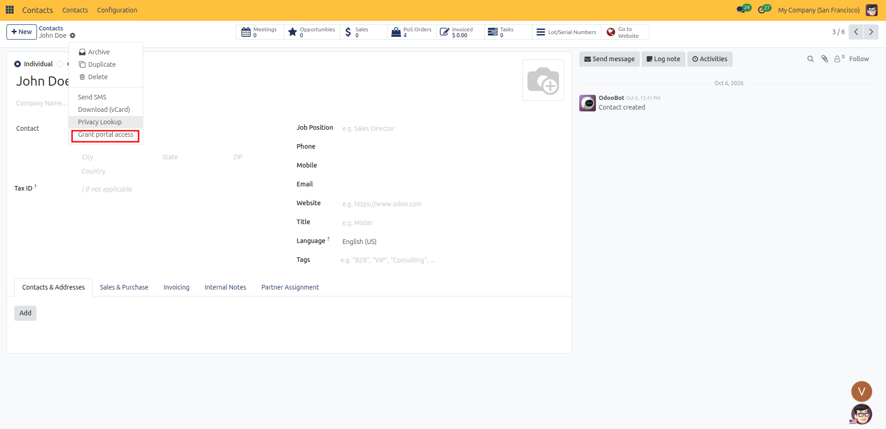
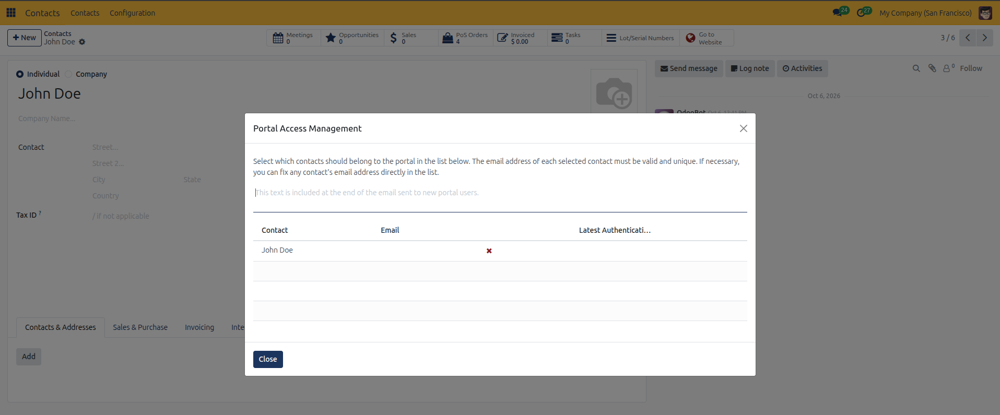
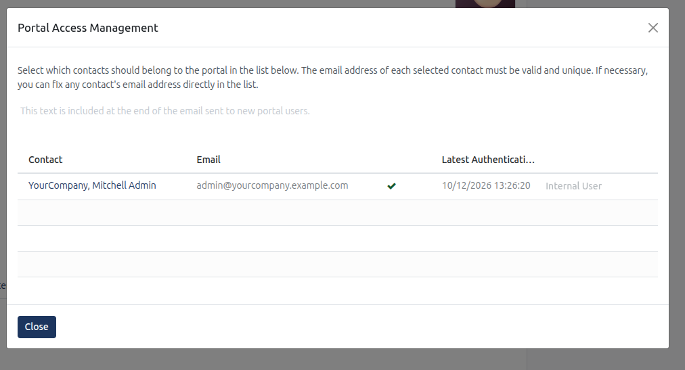
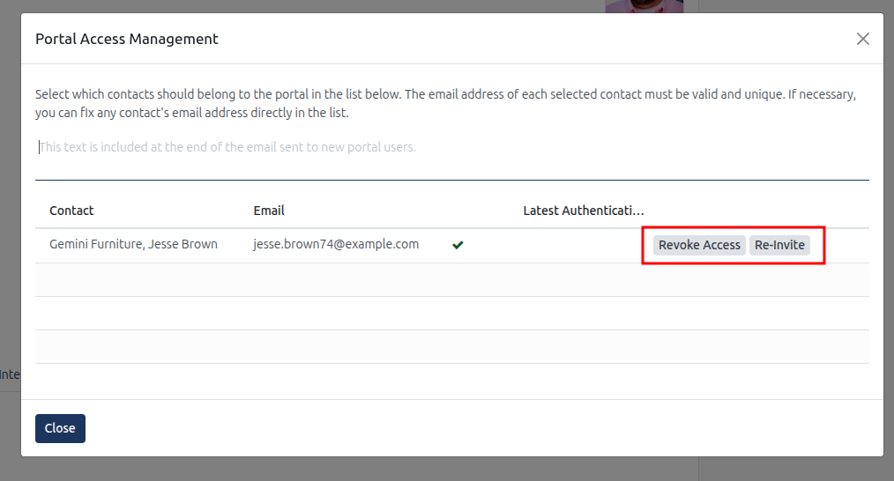

# Granting and Managing Portal Access

Follow these steps to grant, re-invite, and revoke external customer and vendor portal access in CURQ 18:

---

### 1. Open the Portal Access Wizard
1. Open the **Contacts** application from the main dashboard.
2. Search and open the contact card for the customer, vendor, or client representative you wish to invite.
3. Click the **Actions** gear icon at the top of the contact record.
4. Select **Grant portal access** from the dropdown menu to open the **Portal Access Management** dialog.

*(Note: You can also select multiple contacts from the Contacts list view, click **Actions**, and select **Grant portal access** to manage portal accounts in bulk).*

---

### 2. Verify Contact Information and Email Validation
The wizard displays all individual contacts associated with the partner card, along with their current access state:

* **Contact**: The name of the individual or sub-contact receiving portal access.
* **Email**: The email address used for portal login and document notifications.
  * **Green Checkmark**: The email address is formatted correctly and ready for invitation.
  * **Red Cross**: The email address is missing or invalid. You can type or correct the email directly in the table row.
  * **Already Registered**: The email address is already tied to another registered user account in the system.
* **Latest Authentication**: Displays the timestamp of the user most recent login to the web portal.

---

### 3. Grant Portal Access
1. *(Optional)* In the **Invitation Message** text area, type a custom message to include at the end of the invitation email.
2. Locate the contact row and click the **Grant Access** button.
3. CURQ automatically generates the portal user record and emails an onboarding link to the contact.
4. The recipient opens the email link to set their portal password and access their customer portal dashboard.
5. Click **Close** to complete the operation.

---

### 4. Re-Invite Pending Portal Users
If a customer has not activated their portal account or misplaced their setup email:
1. Open the contact in **Contacts** and select **Actions** → **Grant portal access**.
2. Locate the contact row with pending access.
3. Click the **Re-Invite** button.
4. A fresh onboarding link is generated and sent to their email address.
5. Click **Close**.

---

### 5. Revoke Portal Access
When a client representative leaves their company or no longer requires portal visibility:
1. Open the contact record in **Contacts**.
2. Click **Actions** → **Grant portal access**.
3. In the user list, locate the active portal user and click the **Revoke Access** button.
4. The user portal login credentials are removed immediately, preventing future portal access.
5. All historical transactions, quotations, invoices, and communication history attached to the contact record remain completely intact.
6. Click **Close**.

