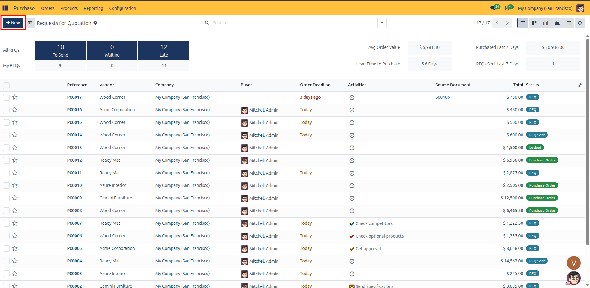
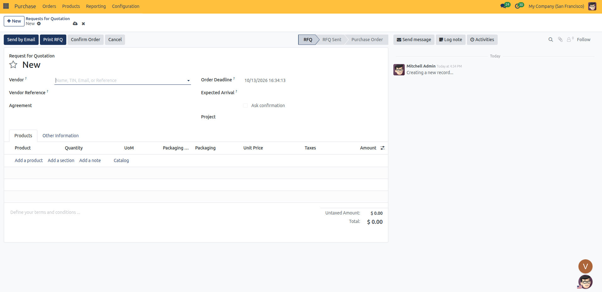
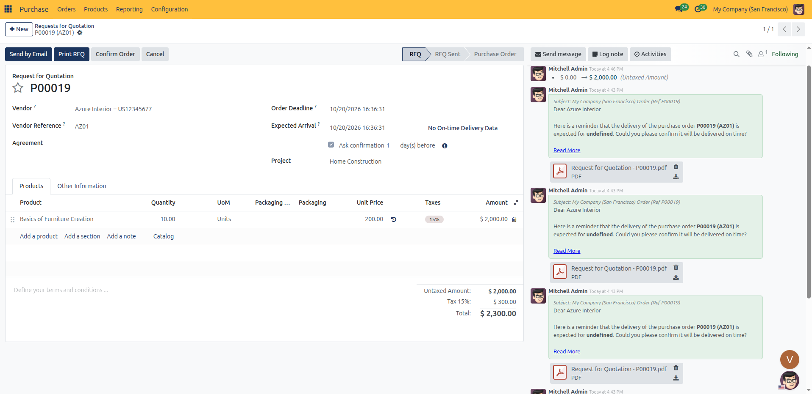

# Creating a Request for Quotation

Follow these quick steps to create a Request for Quotation (RFQ) in CURQ 18:

---

### 1. Start a New RFQ

1. Open the **Purchase** app from the main dashboard.
2. In the top navigation, ensure you are on **Orders → Requests for Quotation**.
3. Click the blue **New** button in the upper-left corner to open a blank RFQ form.

---

### 2. Choose the Vendor

1. Select your supplier in the **Vendor** field.
   The system automatically fills in their default **Currency**, **Payment Terms**, and **Fiscal Position** based on their contact record.
2. In the **Vendor Reference** field, enter any external reference, quotation code, or catalog number provided by the supplier.
3. In the **Order Deadline** field, select the date and time by which the vendor must respond with pricing or quote confirmation.
4. In the **Expected Arrival** field, specify the target delivery date when materials or products are expected at your facility:
   * **On-Time Delivery**: Displays the vendor's historical delivery reliability percentage (or *No On-time Delivery Data* if no completed receipts exist within the past year). Click the link to open the detailed Vendor Delay Report.
   * **Ask confirmation**: Check this box to enable automated receipt reminders. Enter the number of **day(s) before** receipt to automatically email the supplier a confirmation request prior to the scheduled delivery.
5. In the **Deliver To** field, select the destination incoming shipment operation (such as *Receipts* for your primary warehouse).
6. *(Optional)* Select an **Agreement** if ordering against an active blanket order or tender contract.
7. *(Optional)* In the **Project** field, select an active project (such as *Home Construction*) to allocate procurement expenses and material costs directly to that project's profitability sheet. *(This field appears when the Project application is installed)*.

---

### 3. Add Products

1. Under the **Products** tab, click **Add a product**.
2. Select your item in the **Product** column.
   The system automatically populates the **Description** and includes any vendor-specific part code defined in the vendor pricelist.
3. Enter the requested order volume in the **Quantity** column.
4. Verify the **Unit of Measure** (UoM). CURQ defaults to the purchase unit of measure configured on the product record.
5. Check the **Unit Price** column:
   * If an active vendor pricelist rule matches this vendor and quantity, CURQ loads the negotiated price automatically.
   * If no rule applies, CURQ populates the product cost price or leaves the field open for manual entry.
6. Verify the applied **Taxes** mapped by the vendor fiscal position.
7. *(Optional)* Click **Add a section** to organize items under descriptive headings, or click **Add a note** to insert inline instructions for the vendor.
8. Review the calculated financial summary at the bottom right:
   * **Untaxed Amount**: Net line sum before taxes.
   * **Taxes**: Calculated tax total.
   * **Total**: Grand total including taxes.

---

### 4. Other Info Settings (Optional)

Open the **Other Information** tab to verify commercial ownership and accounting details:

| Field | Description |
| :--- | :--- |
| **Buyer** | The internal team member responsible for managing and following up on this purchase request. |
| **Company** | The corporate legal entity or operating branch issuing the RFQ. |
| **Source Document** | The originating sales order, manufacturing order, project, or internal ticket that initiated this procurement need. |
| **Incoterm** | Predefined International Commercial Terms (such as EXW, FOB, CIF, or DDP) standardizing shipping costs, freight risk transfer, and insurance obligations. |
| **Incoterm Location** | The specific port, terminal, city, or delivery destination where the selected Incoterm rule takes legal effect (for example, *Port of Antwerp*). |
| **Payment Terms** | The commercial payment schedule agreed upon with the supplier (such as *Immediate Payment* or *30 Days*). |
| **Fiscal Position** | The tax mapping rule applied to adjust taxes for domestic, intra-community, or international purchases. |

---

### 5. Next Steps

Once your RFQ details are entered and saved:

* Proceed to [Sending Requests for Quotation](02-send-rfq.md) to email the offer directly to the vendor or print an official PDF document.
* Proceed to [Confirming and Managing Purchase Orders](03-confirm-purchase-order.md) once the vendor approves your terms to convert the RFQ into an active purchase order.
