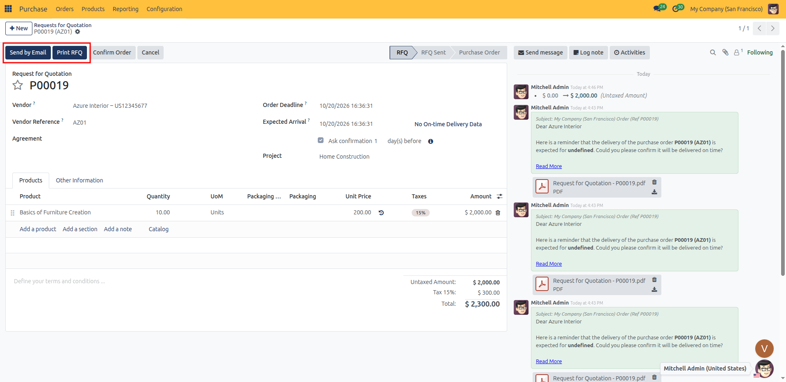
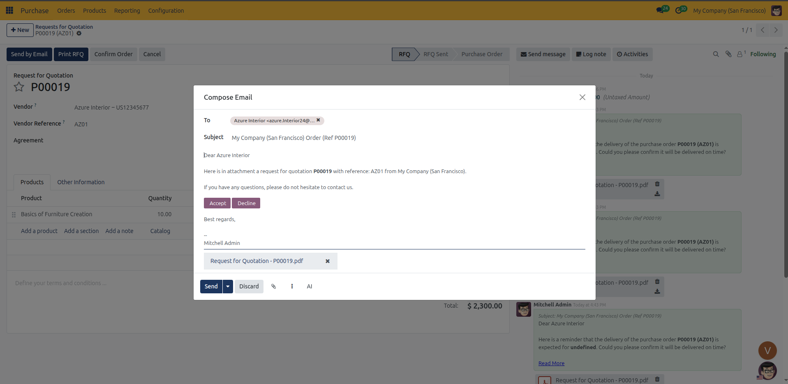
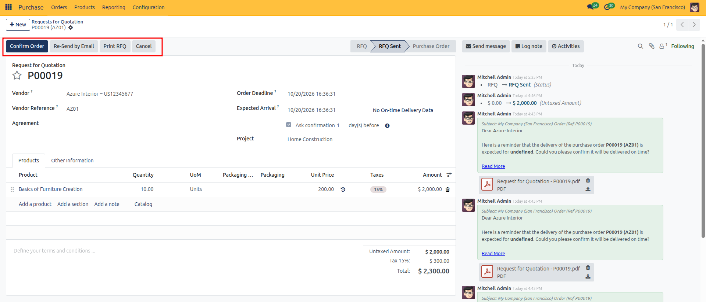

# Sending and Printing Requests for Quotation

Send Requests for Quotation (RFQs) to suppliers by email or print PDF documents in CURQ 18.

---

### 1. Overview

Once a Request for Quotation is drafted with products, expected quantities, and target delivery dates, the next step is sending it to the supplier.

CURQ 18 provides two ways to do this:
* **Send by Email**: Sends an email to the supplier with the quotation PDF attached.
* **Print RFQ**: Downloads a PDF document for printing, physical delivery, or archiving.

Both actions automatically change the status from **RFQ** to **RFQ Sent**, showing your team that you are waiting for the vendor's reply.

---

### 2. Sending the RFQ by Email

Follow these steps to email a quotation request directly to a supplier:

1. Open the draft RFQ from **Purchase → Orders → Requests for Quotation**.
2. Click the **Send by Email** button in the top action bar.

3. An email composer modal appears, pre-populated with standard procurement details:
   * **Recipients**: Defaults to the email address on the vendor contact card. You can add additional recipient email addresses if required.
   * **Subject**: Pre-filled with your corporate entity name and the order reference (such as *Order (Ref P00019)*).
   * **Body**: Standard procurement text addressing the supplier and requesting price and availability confirmation.
   * **Attachments**: An automatically compiled PDF document titled `Request for Quotation - [Reference].pdf`.
   * *(Optional)* Click the paperclip attachment icon to attach external technical drawings, specifications, or compliance documents.

4. Review or edit the message text, then click **Send**.

Upon sending:
* The status badge in the upper right automatically advances from **RFQ** to **RFQ Sent**.
* A permanent audit copy of the outgoing email, recipient list, and attached PDF is recorded in the chatter log on the right side of the screen.

---

### 3. Printing the RFQ Document

For suppliers who require physical paperwork or when hand-delivering procurement documents:

1. Open the draft RFQ from **Purchase → Orders → Requests for Quotation**.
2. Click the **Print RFQ** button in the top action bar.
3. CURQ immediately compiles and downloads the official PDF document to your computer.
4. The system automatically updates the status badge from **RFQ** to **RFQ Sent**.

---

### 4. What Happens in the RFQ Sent Stage

While the document remains in the **RFQ Sent** stage:

* **Primary Highlighted Action**: The **Confirm Order** button becomes highlighted in blue, ready to convert the quotation into an active purchase order once the vendor accepts your terms.
* **Re-Send by Email**: If you modify quantities, specifications, or deadlines while negotiating with the vendor, click **Re-Send by Email** to dispatch an updated offer.
* **Print RFQ**: Click this button at any time to generate an updated PDF copy reflecting current line items.
* **Cancel**: If negotiations fall through or the supplier declines the request, click **Cancel** to close the RFQ.

---

### 5. Next Steps

Once the vendor provides their formal quotation:

* Update the unit prices, delivery dates, or taxes on the RFQ lines to reflect the vendor's agreed terms.
* Proceed to [Confirming and Managing Purchase Orders](03-confirm-purchase-order.md) to confirm the order, lock agreed rates, and trigger warehouse receipt tracking.
