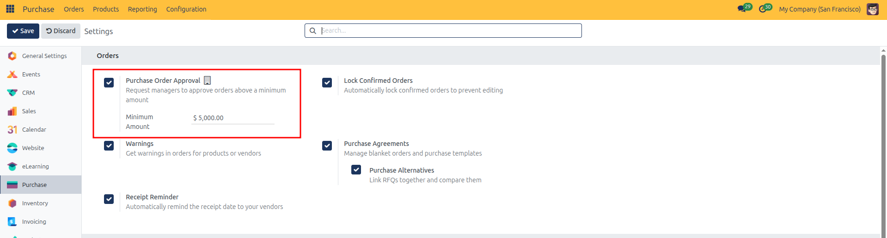
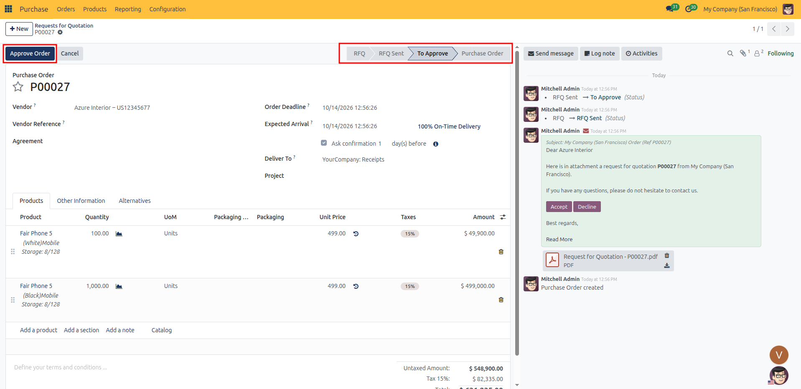
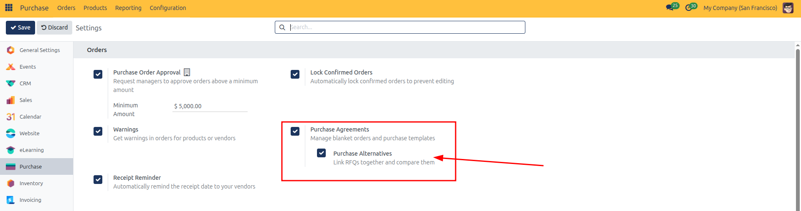
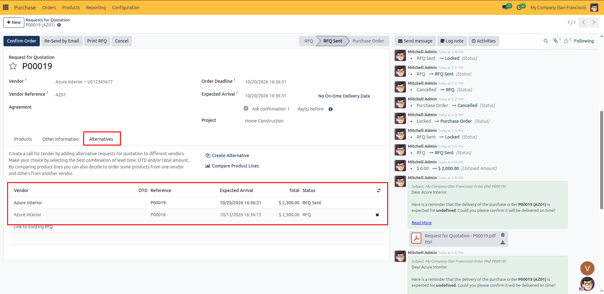
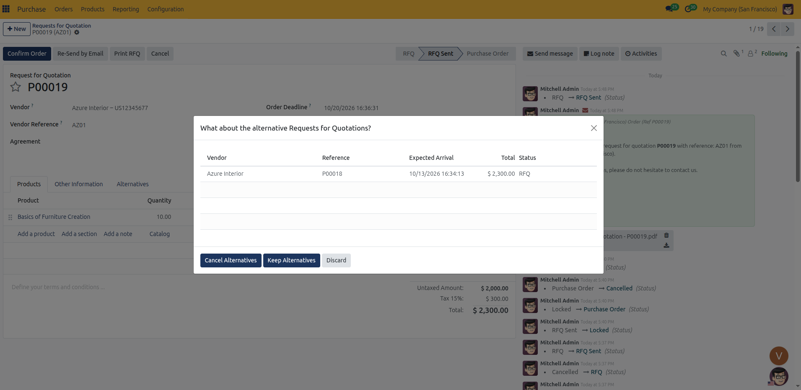
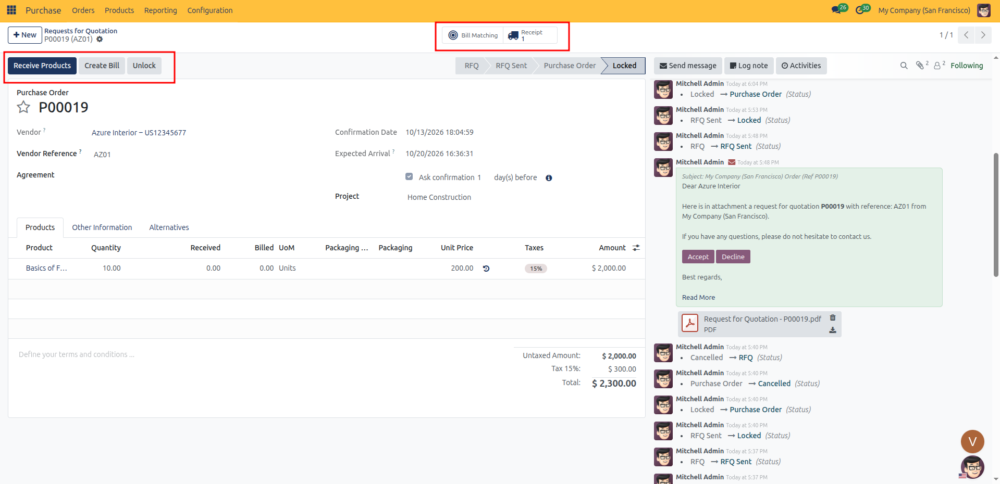
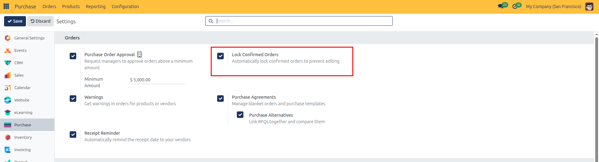
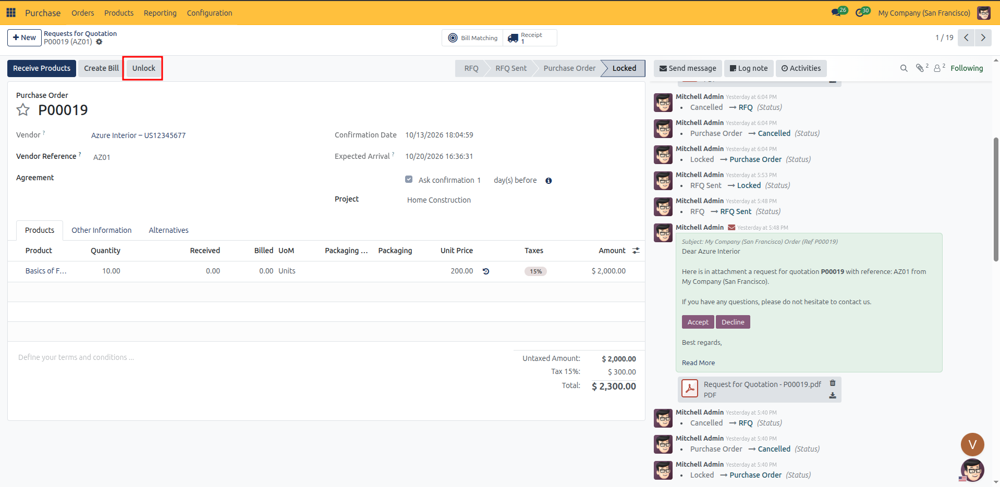
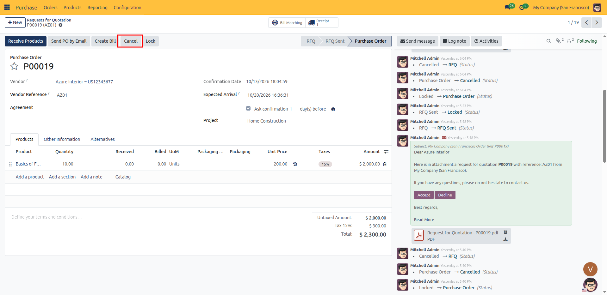
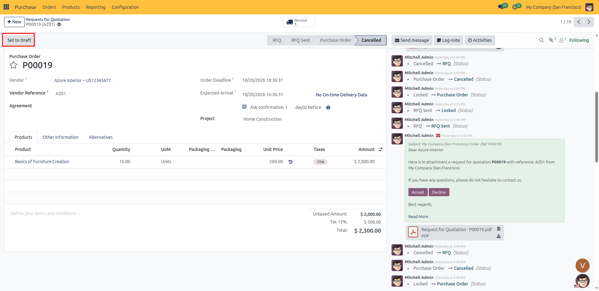

# Confirming and Managing Purchase Orders

Convert Requests for Quotation (RFQs) into official Purchase Orders, lock orders to prevent unwanted changes, and manage order cancellations in CURQ 18.

---

### 1. Confirming an Order Manually

When a supplier accepts your quotation terms or you agree on final pricing:

1. Open the record from **Purchase → Orders → Requests for Quotation** (or open an existing order from **Purchase → Orders → Purchase Orders**).
   *(You can also create an order directly from **Purchase → Orders → Purchase Orders** by clicking **New**)*.
2. Click the **Confirm Order** button in the top action bar.
   *(If the RFQ was previously sent to the vendor, this button is highlighted in blue)*.

#### Manager Approval Gate (For High-Value Orders)
If your company has enabled purchase order approval limits (configured under **Purchase → Configuration → Settings → Purchase Order Approval**):
* If the order total exceeds the minimum approval limit (e.g., `$ 5,000.00`), clicking **Confirm Order** does not confirm the order immediately.
* The order status badge advances to **To Approve**.
* A manager with Purchase Manager permissions must open the order and click the blue **Approve Order** button in the top action bar to complete the confirmation.

#### Final Status and Transmitting to the Supplier
Once confirmed (and approved if required):
1. The document status badge advances directly to **Locked** (when *Lock Confirmed Orders* is active, which is the default) or to **Purchase Order**.
2. The confirmed order is listed under **Purchase → Orders → Purchase Orders**.
3. Click the **Send PO by Email** button in the top action bar to dispatch the official Purchase Order document (`Purchase Order - [Reference].pdf`) to the supplier.

---

### 2. Handling Alternative RFQ Comparisons (Optional)

For standard standalone purchases, clicking **Confirm Order** immediately confirms the purchase order without any prompts.

However, if your organization compares bids from multiple suppliers for the same procurement need, you can enable and compare **Purchase Alternatives**.

#### Step 1: Enable Purchase Alternatives in Settings
1. Navigate to **Purchase → Configuration → Settings**.
2. Under the **Orders** section, check **Purchase Agreements**, then check **Purchase Alternatives**.
3. Click **Save** in the top left.

#### Step 2: Link Competing Quotes
1. Open your Request for Quotation and switch to the **Alternatives** tab (next to *Other Information*).
2. Click **Create Alternative** to generate a copy of the RFQ for a different vendor, or click **Link to Existing RfQ** to group quotes you already created.
3. Compare competing vendor prices, delivery dates, and terms directly from the list.

#### Step 3: Confirm and Resolve Competing Quotes
1. When you decide which vendor quote to accept, click **Confirm Order** on that chosen RFQ.
2. CURQ detects the linked competing quotes and opens the dialog: *"What about the alternative Requests for Quotations?"*

3. Choose your resolution:
   * **Cancel Alternatives**: Automatically cancels all competing RFQs so they cannot be ordered accidentally.
   * **Keep Alternatives**: Leaves the competing RFQs active in case you need to order additional quantities from those vendors later.
4. Click your preferred button to finalize the confirmation.

---

### 3. What Happens Automatically on Confirmation

When you confirm a purchase order, CURQ automates several background actions and locks key fields to prevent tampering:

| System Action | Details |
| :--- | :--- |
| **Status Update** | The document status badge moves to **Purchase Order** (or **Locked** if *Lock Confirmed Orders* is active). |
| **Confirmation Date Replaces Deadline** | The editable **Order Deadline** field is hidden. In its place, CURQ displays a system-generated **Confirmation Date** timestamp that is strictly **read-only**. |
| **Vendor Field Locks to Read-Only** | The **Vendor** selector becomes read-only to prevent switching suppliers on an approved agreement. |
| **Line-Level Restrictions** | The product selection and Unit of Measure on order lines become read-only. Two new tracking columns appear in the table: **Received** and **Billed**. |
| **Incoming Receipt Creation** | For physical or storable products, CURQ generates an incoming shipment receipt linked directly to the order. A **Receipt** smart button (truck icon) appears in the top stat area. |
| **Receive Products Button** | For physical goods, a blue **Receive Products** button appears in the top action bar so warehouse receiving can be validated directly from the order. |
| **Send PO by Email** | A **Send PO by Email** button appears, allowing you to send the official Purchase Order confirmation and PDF to the vendor. |
| **Billing Readiness** | The **Create Bill** button becomes available based on your product control policy (*On ordered quantities* or *On received quantities*). |

*(Note: If your purchase order only contains **Service** products such as training or consulting, no warehouse receipt is created because services do not require physical shipping. In this case, neither the **Receive Products** button nor the **Receipt** truck smart button will appear.)*

---

### 4. Locking and Unlocking Confirmed Orders

Locking an order protects approved quantities, prices, and vendor agreements from accidental alterations.

#### Automatic Order Locking
In standard CURQ 18 configuration (**Purchase → Configuration → Settings → Orders → Lock Confirmed Orders**), confirmed orders are **automatically locked immediately upon confirmation**. 

When an order is locked:
* The status badge displays **Locked**.
* All order lines, quantities, and prices become completely read-only.
* An **Unlock** button appears in the top action bar.

#### How to Unlock and Modify an Order
If you need to adjust quantities, unit prices, or delivery dates after confirmation:

1. Open the locked purchase order.
2. Click the **Unlock** button in the top action bar.

3. The document returns to the editable **Purchase Order** status.
4. Make the necessary adjustments to product lines, quantities, or scheduled dates.
5. Click the **Lock** button in the action bar to re-lock the purchase order and protect it from further changes.

---

### 5. Cancelling and Reactivating a Purchase Order

If an order cannot be fulfilled or negotiations fall through:

1. If the order is currently locked, click **Unlock** first.
2. Click the **Cancel** button in the top action bar.

3. The order status updates to **Cancelled**.
4. Any linked incoming receipts that have not yet been received are automatically cancelled.
5. If the purchase becomes active again later, click **Set to Draft** in the top action bar to reopen the document as an active draft RFQ.

---

### 6. Next Steps

Once your purchase order is confirmed:

* Proceed to [Managing Purchase Orders & Operational Views](04-manage-purchase-orders.md) to navigate views, filter by billing and delivery status, and run batch operations.
* Proceed to [Receiving Products and Shipments](05-receive-products.md) to inspect incoming goods, validate delivery quantities, and manage backorders.
* Proceed to [Vendor Bills & Bill Control](06-vendor-bills-and-matching.md) once the vendor sends their invoice to generate vendor bills and reconcile billed quantities according to your control policy.
