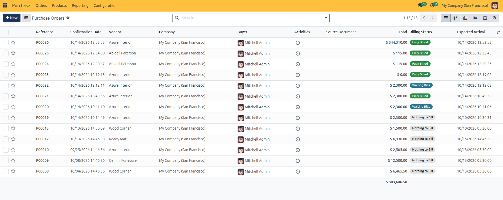
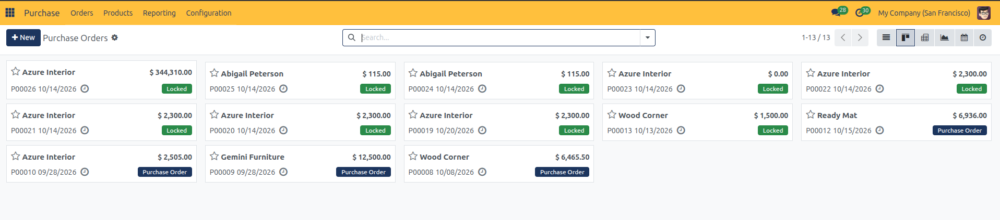
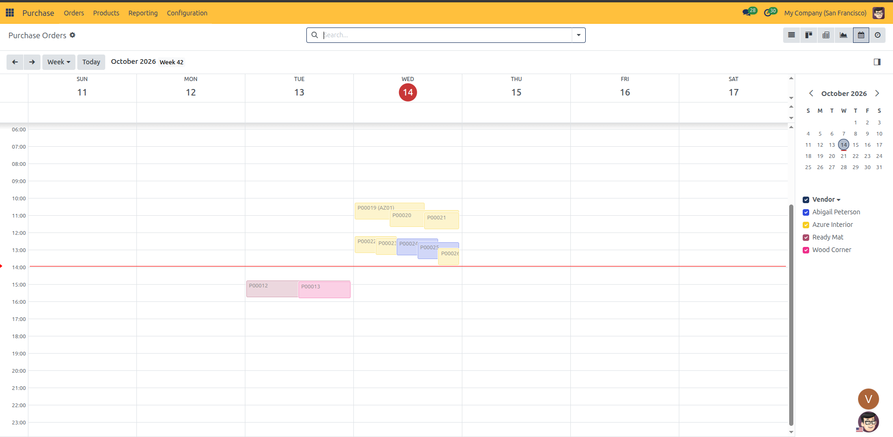
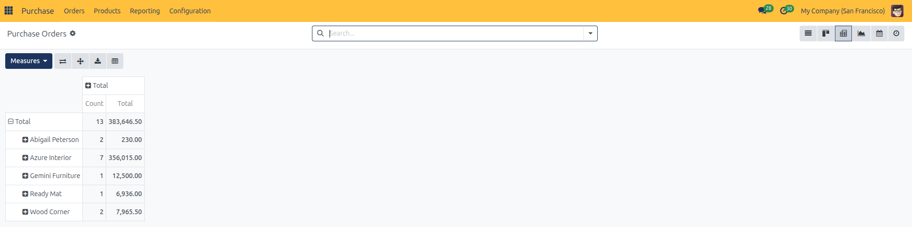
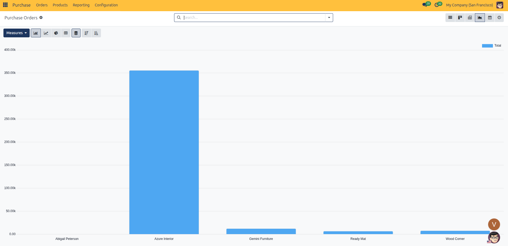
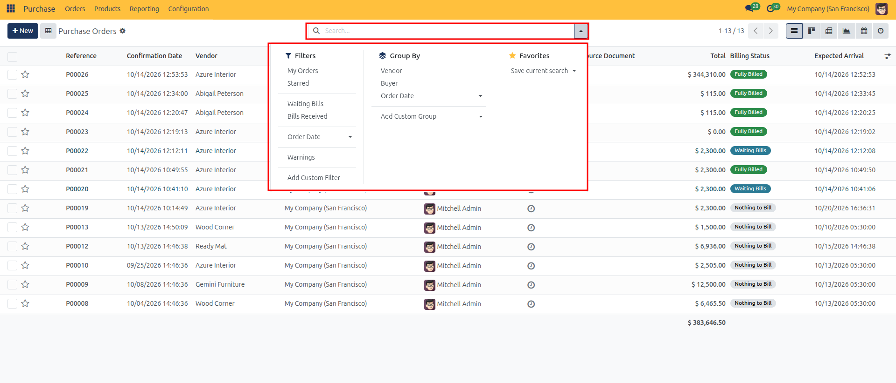
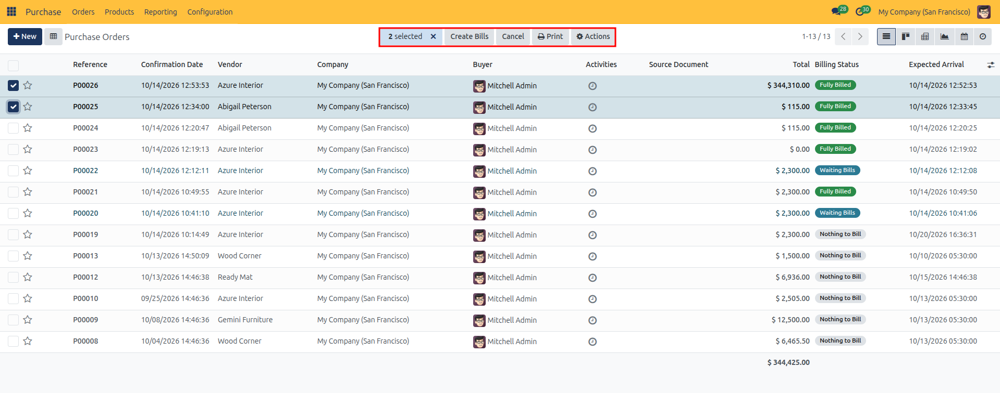

# Managing Purchase Orders & Operational Views

Navigate the Purchase Orders workspace, browse confirmed orders across List, Kanban, Calendar, and Activity views, filter by billing and delivery status, and perform batch operations in CURQ 18.

---

### 1. Accessing the Purchase Orders Workspace

While Requests for Quotation (RFQs) represent pending negotiations, the **Purchase Orders** menu is the dedicated command center for all confirmed, active, and completed procurement contracts.

#### How to Open Purchase Orders
1. Open the **Purchase** application from the main dashboard.
2. In the top navigation bar, select **Orders → Purchase Orders**.
3. CURQ displays all confirmed purchase orders (records in *Purchase Order* or *Locked* status).

*(Note: You can initiate a new procurement order directly from this screen by clicking the blue **+ New** button in the upper-left corner)*.

---

### 2. Switching Between Operational Views

In the upper-right corner of the screen, CURQ provides a view switcher allowing you to examine purchase orders from multiple operational angles:

| View | Purpose | Key Features |
| :--- | :--- | :--- |
| **List View** | Standard tabular spreadsheet. | Displays reference numbers, vendor names, buyers, expected arrival dates, order totals, and real-time billing status badges. |
| **Kanban View** | Visual card layout. | Displays compact cards showing supplier name, total order amount, scheduled arrival date, priority star, and status badge. |
| **Pivot View** | Multi-dimensional aggregation table. | Summarizes total spend and order counts segmented by vendor with expandable drill-down levels. |
| **Graph View** | Visual chart analytics. | Generates bar, line, and pie charts comparing procurement spend across suppliers. |
| **Calendar View** | Scheduled delivery timeline. | Plots expected delivery arrival dates across a monthly, weekly, or daily grid to help warehouse teams prepare for incoming freight. |
| **Activity View** | Communication and task tracker. | Displays a centralized matrix of scheduled calls, emails, reminders, and to-do activities linked to each purchase order. |

To switch views, click any of the view icons in the top-right toolbar:

#### Kanban View
Click the **Kanban** icon (second from left) for a visual card overview of active vendor contracts, total amounts, and locked status indicators.

#### Calendar View
Click the **Calendar** icon to inspect incoming shipments scheduled across the week or month, color-coded by supplier.

#### Pivot View
Click the **Pivot** icon to summarize purchase spend by vendor, analyze order counts, and slice metrics across custom dimensions.

#### Graph View
Click the **Graph** icon to visualize procurement expenditure by vendor using interactive bar, line, or pie charts.

---

### 3. Understanding the List View Columns

The default **List View** displays essential procurement tracking data in an organized table:

| Column | Description |
| :--- | :--- |
| **Priority (Star)** | A star icon preceding the order number. Click the star to flag high-priority orders for rapid filtering and urgent follow-up. |
| **Reference** | The unique system sequence number (e.g., `P00026`). Confirmed orders display in bold text. |
| **Confirmation Date** | The official timestamp when the purchase order was confirmed or approved. |
| **Vendor** | The supplier contracted for the order. |
| **Company** | In multi-company environments, the operating branch or legal entity that placed the order. |
| **Buyer** | Avatar and name of the internal purchasing agent responsible for managing the order. |
| **Activities** | Clock icon indicating scheduled follow-up tasks, calls, or deadlines linked to the order. |
| **Source Document** | The originating sales order, project, or requisition that triggered the purchase. |
| **Total** | The final gross order value including taxes. Total sum across all records is displayed at the bottom of the table. |
| **Billing Status** | Color-coded status badge showing invoicing progress: **Waiting Bills** (blue badge indicating goods received or ordered awaiting a vendor bill), **Fully Billed** (green badge indicating all quantities matched to posted bills), or **Nothing to Bill** (grey badge indicating order contains no billable items or has been cancelled). |
| **Expected Arrival** | The scheduled delivery arrival timestamp agreed with the supplier. |

---

### 4. Searching, Filtering, and Grouping Orders

Use the central search bar at the top of the screen to quickly isolate specific orders, aggregate contracts, and save operational views:

#### Standard Search Filters
Click inside the search bar to reveal pre-configured search filters:
* **My Orders**: Filters for purchase orders where you are assigned as the responsible Buyer.
* **Starred**: Filters for orders you have flagged with a priority star.
* **Waiting Bills**: Displays confirmed orders where goods have been received or ordered but vendor bills have not yet been posted.
* **Bills Received**: Filters for orders that have been completely invoiced.
* **Order Date**: Granular date filtering segmented by **Year**, **Quarter**, **Month**, **Week**, or **Day**.
* **Warnings**: Filters for purchase orders containing log warnings or delayed delivery notices.
* **Add Custom Filter**: Build custom multi-condition search rules using any field on the purchase order.

#### Group By Dimensions
Organize your purchase orders into structured, expandable categories:
* **Vendor**: Groups all orders by supplier, allowing you to review order history and volume per vendor.
* **Buyer**: Groups orders by internal purchasing representative.
* **Order Date**: Segments orders chronologically by month or quarter.
* **Add Custom Group**: Group records by any purchase order field (e.g., Company, Currency, Source Document).

#### Favorites
* **Save current search**: Save frequently used filter and grouping combinations to access them instantly from the Favorites dropdown or share them with all users.

---

### 5. Performing Batch Operations

The List View enables buyers and accounts payable teams to perform actions across multiple purchase orders simultaneously:

#### Step 1: Select Orders
Check the box next to individual purchase orders, or click the master checkbox in the table header to select all visible orders. A batch control bar appears above the list displaying the number of selected records (e.g., **2 selected**).

#### Step 2: Choose a Batch Action
Once records are selected, action buttons appear in the top list header:

* **Create Bills**: Automatically drafts vendor bills for all selected purchase orders in a single click, saving time during high-volume month-end invoicing.
* **Cancel**: Batch-cancels all selected orders (CURQ prompts for confirmation to prevent accidental cancellations).
* **Print**: Batch-generates and downloads compiled PDF purchase order documents for all selected records.
* **Actions Menu (Gear Icon)**:
  * **Export**: Downloads selected purchase orders into an Excel (`.xlsx`) or CSV spreadsheet.
  * **Duplicate**: Clones the selected purchase order to create a new draft order with identical line items.
  * **Archive / Unarchive**: Removes closed historical orders from active search views without deleting audit data.

---

### 6. Next Steps

With your confirmed purchase orders organized and monitored:

* Proceed to [Receiving Products and Shipments](05-receive-products.md) to inspect incoming goods, validate warehouse receipts, and manage backorders.
* Proceed to [Vendor Bills & Bill Control](06-vendor-bills-and-matching.md) to generate vendor bills, enforce control policies, and reconcile billing lines.
* Proceed to [Purchase Agreements](07-purchase-agreements.md) to establish long-term blanket contracts and recurring purchase templates.
