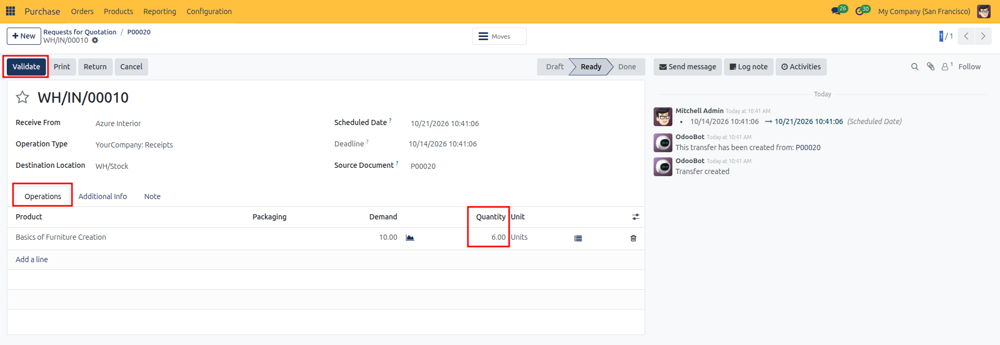
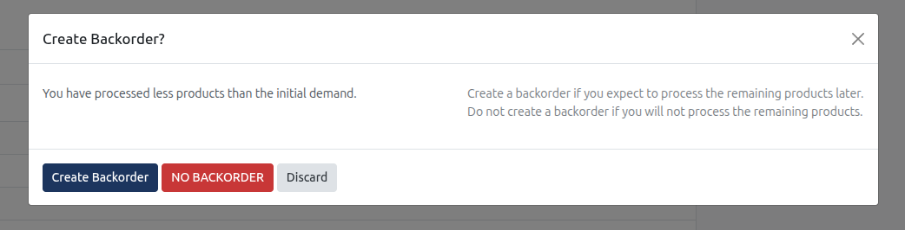
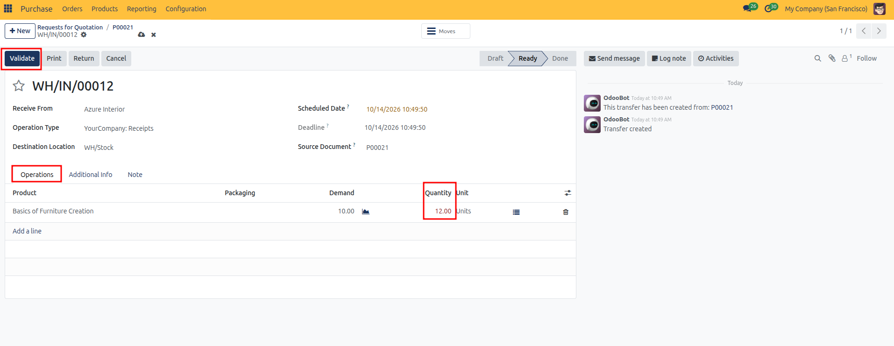
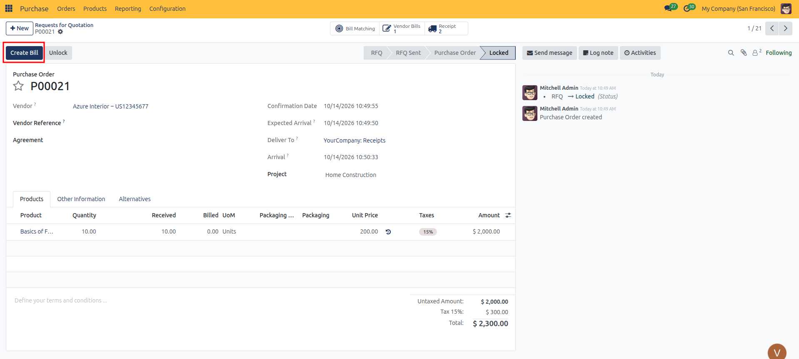
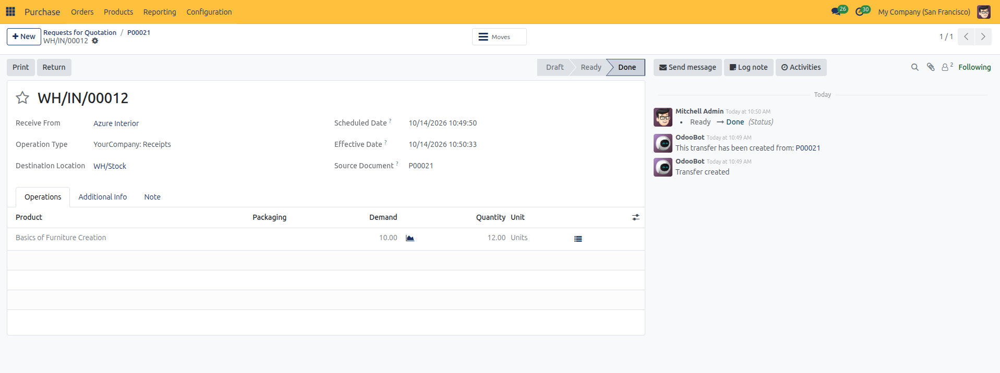
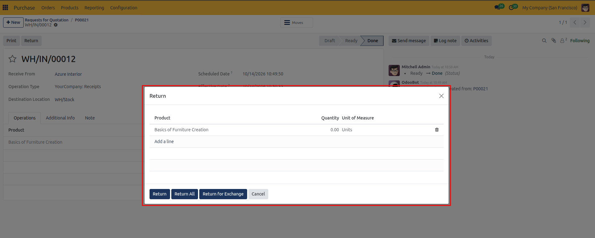
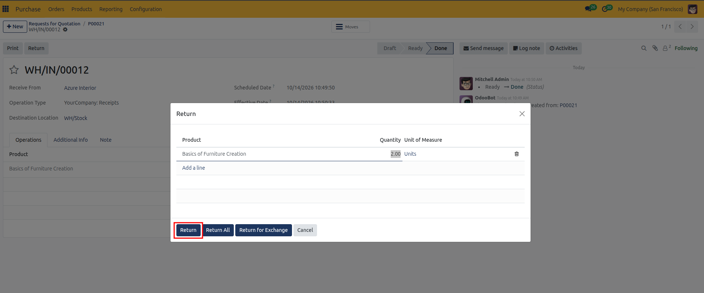
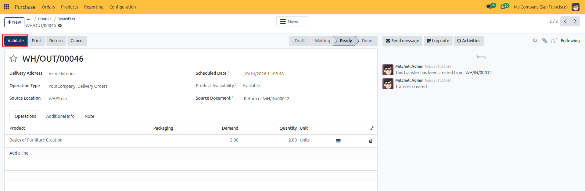
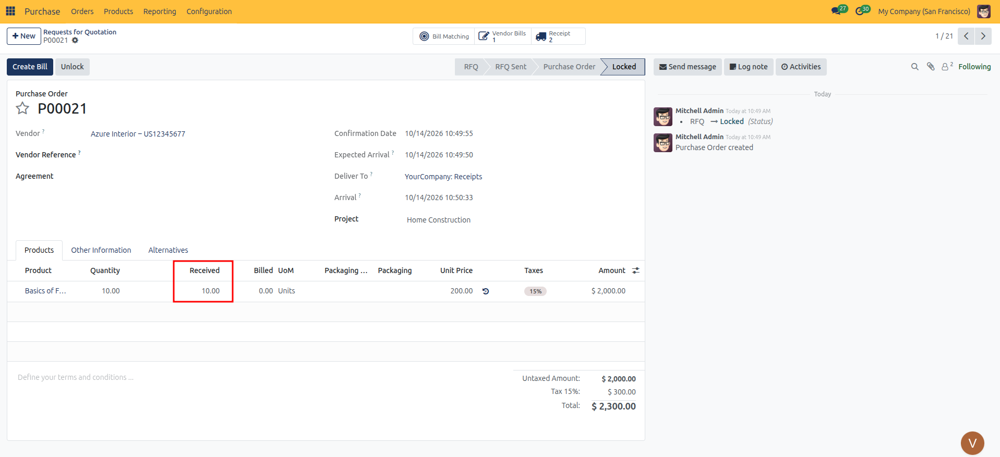

# Receiving Products and Shipments

Track incoming vendor deliveries, validate warehouse receipts, manage partial shipments with automated backorders, and handle vendor returns in CURQ 18.

---

### 1. Overview of Goods Receipts

When you confirm a Purchase Order for physical goods, CURQ automatically generates an incoming receipt linked directly to the order. 

Purchasing teams can inspect incoming deliveries, confirm received quantities, and manage vendor returns directly from the purchase order workspace without navigating away.

---

### 2. Accessing the Incoming Receipt

To open and process the incoming shipment from your purchase order:

1. Open the confirmed order from **Purchase → Orders → Purchase Orders**.
2. Click the blue **Receive Products** button in the top action bar, or click the **Receipt** smart button (truck icon) in the top-right stat area.
3. CURQ immediately opens the linked incoming receipt form.

---

### 3. Understanding the Receipt Form

The receipt document (typically prefixed with `WH/IN/`) tracks shipment logistics and line quantities:

| Field | Description |
| :--- | :--- |
| **Receive From** | The vendor supplying the items, automatically linked from the purchase order. |
| **Operation Type** | The operational route handling the arrival (for example, *YourCompany: Receipts*). |
| **Destination Location** | The physical warehouse location where received goods will be deposited (typically `WH/Stock`). Visible when storage locations are enabled. |
| **Scheduled Date** | The planned arrival date and time for the delivery. |
| **Deadline** | The final target date by which the vendor delivery must be completed to prevent late procurement delays. |
| **Source Document** | The purchase order reference number linking this shipment back to the original order (for example, `P00019`). |

#### The Operations Tab (Stock Moves)
The rows in the **Operations** tab represent the individual **Stock Moves** created from your purchase order lines:

| Column | Description |
| :--- | :--- |
| **Product** | The physical item being received and transferred into inventory. |
| **Packaging** | The packaging container or pack size (such as Box of 10 or Pallet) if product packaging is configured. |
| **Demand** | The exact quantity ordered on the originating purchase order line. |
| **Quantity** | The actual count verified upon delivery and being transferred into stock. |
| **Unit** | The unit of measure used for counting and storing the product (for example, Units, Bags, or Liters). |

#### The Additional Info Tab
The **Additional Info** tab records carrier details, organizational ownership, and cross-module linkages:

##### Shipping Information
| Field | Description |
| :--- | :--- |
| **Carrier** | The third-party logistics provider or delivery service transporting the goods. |
| **Tracking Reference** | The tracking number or bill of lading provided by the supplier or freight carrier. |
| **Weight** | The total calculated net weight of the products being received based on the weight values in product records. |
| **Weight for shipping** | The gross weight including packaging, boxes, or pallets used for shipping calculations. |

##### Other Information
| Field | Description |
| :--- | :--- |
| **Responsible** | The internal user responsible for supervising or verifying this receipt. |
| **Sales Order** | If this purchase was triggered automatically to fulfill a customer sales order, this field links the receipt to that customer order. |
| **Company** | The operating company and legal entity receiving the inventory. |
| **Project** | Links the receipt directly to a project for tracking materials and procurement costs. |

#### The Note Tab
The **Note** tab provides a free-text area for internal receiving comments, delivery bay instructions, or packaging notes. Notes entered here print on the physical receipt operations sheet.

---

### 4. Receiving a Full Delivery

When the entire order arrives as expected with no shortages or damaged items:

1. Open the incoming receipt.
2. Ensure the counted items match the **Demand** column.
3. Click the **Validate** button in the top action bar.
4. CURQ marks all items as fully received, updates on-hand stock levels, and moves the status badge from **Ready** to **Done**.

---

### 5. Handling Partial Deliveries and Backorders

Suppliers frequently deliver orders in multiple shipments due to stock availability or logistics constraints. CURQ makes it easy to accept partial quantities while tracking the remaining items.

#### Step 1: Record the Delivered Quantity
1. Open the incoming receipt.
2. In the **Operations** tab, click on the **Quantity** field for the delivered item.
3. Enter the quantity actually delivered (for example, enter `6` if only 6 out of 10 items arrived).

4. Click **Validate** in the top action bar.

#### Step 2: Choose Backorder Resolution
Because the received count is less than the original demand, CURQ opens the **Create Backorder?** prompt:

* **Create Backorder**: CURQ validates the received items, marks this initial shipment as **Done**, and automatically creates a new incoming receipt for the remaining balance. The backorder stays in **Ready** status waiting for the vendor's next delivery.
* **No Backorder**: CURQ validates only the delivered items and cancels the remaining balance. Use this if the vendor will not be shipping the missing goods and the purchase order is considered complete.
* **Discard**: Closes the dialog and returns to the receipt form without processing the delivery.

---

### 6. Handling Over-Deliveries

Suppliers may sometimes send more units than originally specified on your purchase order. CURQ handles this flexibly without halting operations.

#### Step 1: Record the Excess Quantity
1. Open the incoming receipt.
2. In the **Quantity** column, enter the actual count received (for example, `12` when the **Demand** was `10`).
3. CURQ immediately highlights the quantity in **red** to visually signal that this delivery exceeds the purchase agreement.

#### Step 2: Validate the Delivery
1. Click the **Validate** button in the top action bar.
2. CURQ accepts the transfer without blocking:
   * All delivered units (including the extra items) are added to your available on-hand stock.
   * The receipt moves to **Done** status.

#### Step 3: Purchase Order & Billing Impacts
After validating an over-delivery:
* **Purchase Order Lines**: The ordered quantity remains as originally agreed (e.g., `10.00`), while the **Received** column updates to the full delivered count (e.g., `12.00`).
* **Vendor Bill Impact**:
  * **On Received Quantities Policy**: When you click **Create Bill**, CURQ prepares the vendor bill for the actual received count (`12.00`). If the vendor charges for the extra items, accounts payable can match and pay the bill directly.
  * **On Ordered Quantities Policy**: CURQ drafts the vendor bill for only the agreed quantity (`10.00`). If the supplier invoices for the extra units, the draft bill requires manual review or a purchase order amendment before posting.

#### What to Do If You Reject Excess Items
* **Reject at Delivery**: Enter only the contracted demand quantity (e.g. `10`) in the **Quantity** column and turn away the extra items with the freight carrier.
* **Return After Receiving**: If the shipment has already been validated, open the receipt, click the **Return** button, enter the excess quantity (e.g. `2`), and click **Return** to generate an outgoing vendor return document.

---

### 7. Post-Receipt Updates on the Purchase Order

Once a warehouse receipt is validated, CURQ synchronizes the purchase order automatically:

1. Navigate back to the purchase order (**Purchase → Orders → Purchase Orders**).
2. Look at the order lines in the **Products** tab:
   * The **Received** column reflects the verified delivered quantity.
   * If all lines have been fulfilled, the order is marked as fully received.
3. If your billing control policy is set to *On received quantities*, the **Create Bill** button highlights in blue, ready for accounts payable to process the vendor bill.

---

### 8. Returning Goods to the Vendor

If received items are damaged, incorrect, or surplus (such as excess units from an over-delivery), you can return them directly from the receipt.

#### Step 1: Initiate the Return
1. Open the validated receipt (the status badge must show **Done**).
2. Click the **Return** button in the top action bar.

#### Step 2: Specify Return Quantities and Action
CURQ opens the **Return** dialog listing the products from the original shipment:

1. In the **Quantity** column, enter the exact number of units being returned (for example, enter `2.00` to return the 2 excess units from an over-delivery).
2. Choose your return action button:
   * **Return**: Generates an outgoing return shipment back to the supplier for the specified quantities.
   * **Return All**: Automatically enters the full delivered quantity for all lines.
   * **Return for Exchange**: Creates both an outgoing return document and a replacement incoming receipt for replacement goods.
   * **Cancel**: Closes the dialog without creating a return.

3. Click the **Return** button to confirm.

#### Step 3: Validate the Outgoing Return
1. CURQ creates a new outgoing return document (prefixed `WH/OUT/`).
2. Verify the items and quantities with the logistics carrier.
3. Click the **Validate** button in the top action bar to confirm that the carrier has collected the goods.

#### Step 4: Purchase Order Synchronization
Once the return is validated, CURQ immediately updates the purchase order:
* The **Received** column on the order line automatically subtracts the returned quantity (for example, updating from `12.00` back down to `10.00`).
* The **Receipt** smart button in the top-right stat area now shows **2 Receipts** (one incoming delivery and one outgoing return).
* The **Create Bill** button aligns strictly with the net accepted quantity, protecting your accounts payable team from overpaying.

---

### 9. Next Steps

With incoming goods verified and received:

* Proceed to [Vendor Bills & Bill Control](06-vendor-bills-and-matching.md) to generate vendor bills, control billable amounts based on received quantities, and complete payment reconciliation.
