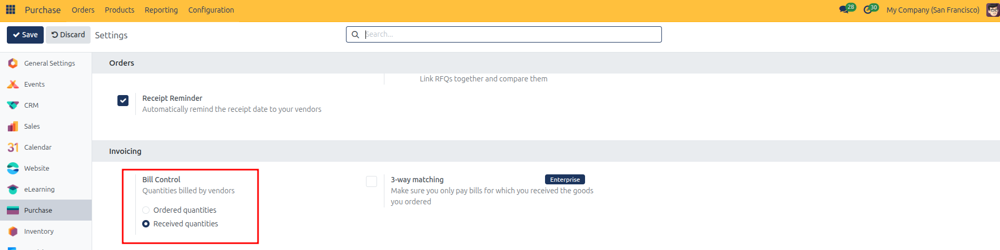
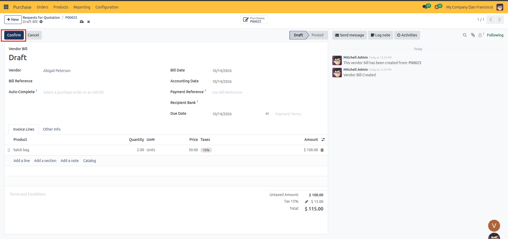
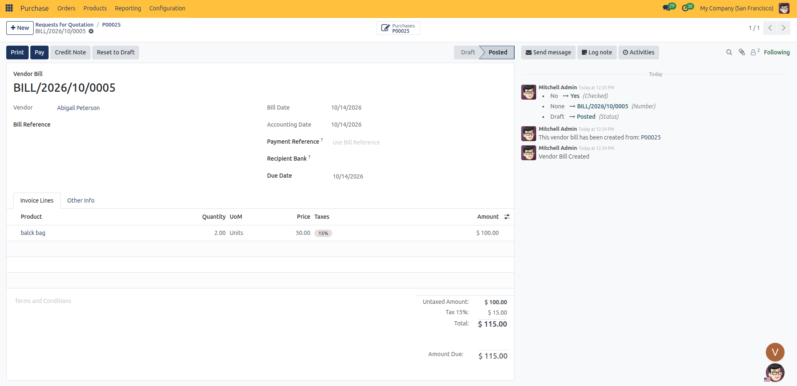
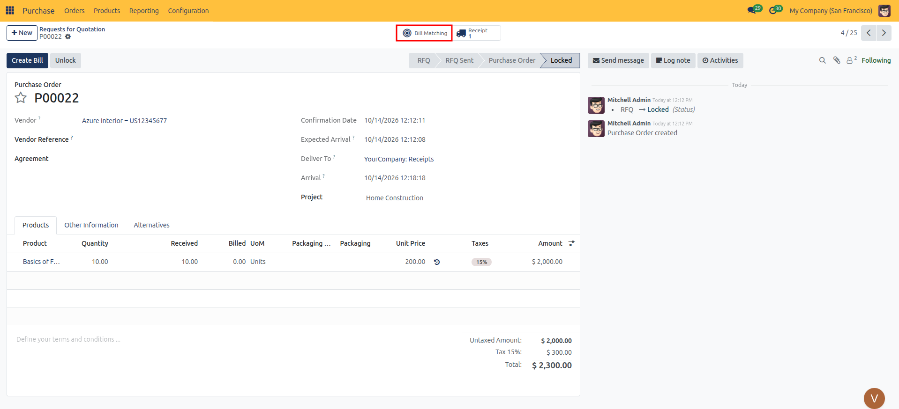
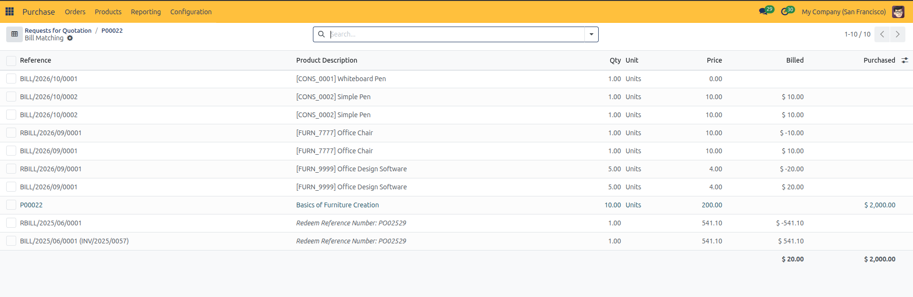
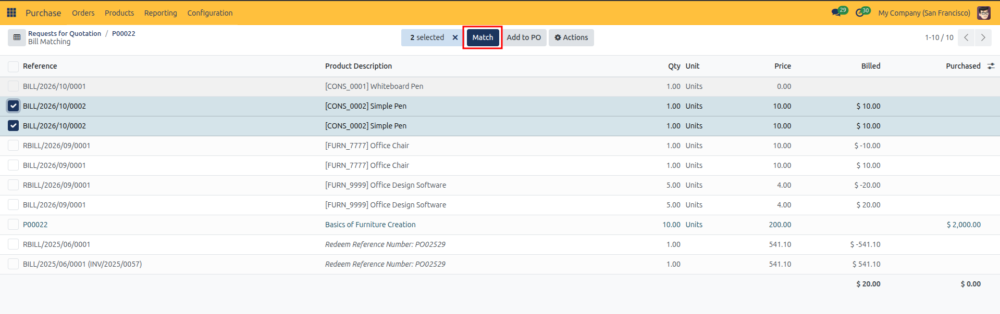
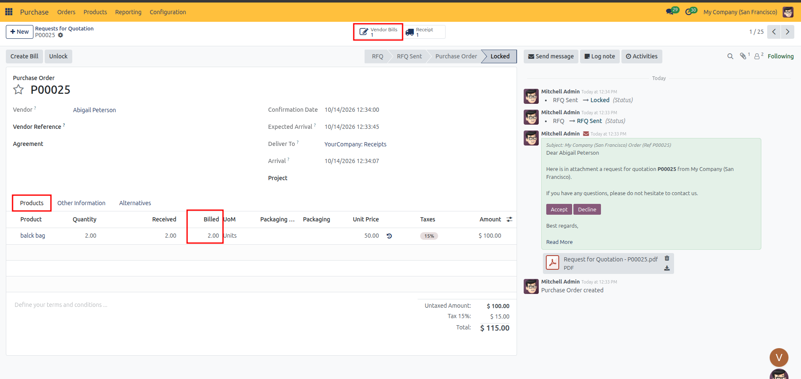

# Vendor Bills & Bill Control

Generate vendor bills from purchase orders, enforce control policies based on ordered versus received quantities, and reconcile billing lines using CURQ 18 bill matching.

---

### 1. Overview of Vendor Billing

When a supplier invoices your company for goods or services, accounts payable creates a **Vendor Bill**. In CURQ 18, vendor bills can be created directly from the purchase order, ensuring that invoiced amounts and quantities stay aligned with approved procurement contracts and verified warehouse deliveries.

---

### 2. Understanding Bill Control Policies

#### Configuring the Global Default Policy
You can set a company-wide default bill control policy so that all new products automatically receive your preferred rule:

1. Navigate to **Purchase → Configuration → Settings**.
2. Scroll to the **Invoicing** section.
3. Under **Bill Control** (*Quantities billed by vendors*), select:
   * **Ordered quantities**: Newly created products default to billing based on purchase order quantities.
   * **Received quantities**: Newly created products default to requiring incoming delivery receipts before bills can be generated.
4. Click **Save** in the top-left corner.

#### Control Policy Types
Every product record in CURQ defines a **Control Policy** that determines when and how a purchase order can be billed:

| Control Policy | How It Works | Best Used For |
| :--- | :--- | :--- |
| **On Received Quantities** | The purchase order cannot be billed until goods are physically received and verified on an incoming receipt. The billed quantity automatically defaults to the received count. | Physical goods, raw materials, equipment, and high-value supplies. |
| **On Ordered Quantities** | The purchase order can be billed immediately after confirmation, before any items are delivered. The billed quantity defaults to the ordered quantity. | Service contracts, recurring subscriptions, prepaid consulting, or software licenses. |

*(Note: If you attempt to click **Create Bill** on an order containing only products set to On Received Quantities before validating a receipt, CURQ alerts you that there are no billable lines available yet.)*

#### Configuring the Policy on Individual Products
You can customize or override the control policy on any specific product record:

1. Navigate to **Purchase → Products → Products**.
2. Select the product you want to configure.
3. Switch to the **Purchase** tab.
4. In the **Vendor Bills** section on the right, locate the **Control Policy** options:
   * Select **On received quantities** for items requiring receipt verification.
   * Select **On ordered quantities** for prepayments, direct-drop shipments, or intangible services.
5. Save the product record.

---

### 3. Generating a Vendor Bill from a Purchase Order

Once your order is eligible for billing (either goods are received or policy allows billing on order):

#### Step 1: Open the Purchase Order
1. Navigate to **Purchase → Orders → Purchase Orders**.
2. Open the confirmed purchase order.
3. Click the blue **Create Bill** button in the top action bar.
   *(Alternatively, click the **Vendor Bills** smart button in the top-right stat area if a bill already exists)*.
4. CURQ automatically drafts a new vendor bill pre-filled with the order's vendor, products, quantities, prices, and applicable taxes.

#### Step 2: Verify Bill Header Information
Review all key header fields on the draft bill:

| Field | Description |
| :--- | :--- |
| **Vendor** | The supplier issuing the invoice, populated automatically from the purchase order along with their physical address and Tax ID. |
| **Bill Reference** | The supplier's own printed invoice number (e.g., `INV-2026-9042`). Enter this reference to ensure tracking and prevent duplicate entries. |
| **Auto-Complete** | A search field that lets you select a confirmed purchase order or past bill to automatically populate all bill lines, pricing, and vendor details. |
| **Bill Date** | The issuance date printed on the vendor's physical invoice. This field is required before posting the bill. |
| **Accounting Date** | The accounting period date on which the transaction is posted to the company ledger. Defaults to today's date. |
| **Payment Reference** | The payment identifier or communication text (such as the vendor bill reference or PO reference) included in bank remittances. |
| **Recipient Bank** | The verified vendor bank account where payment will be deposited. |
| **Payment Terms / Due Date** | The payment terms agreed with the supplier (e.g., *End of Following Month*, *30 Days*, or *Immediate Payment*). If specific terms are not set, you can specify an explicit **Due Date**. |

#### Step 3: Review the Invoice Lines Tab
Verify the invoiced items, quantities, and pricing against the vendor's invoice:

| Column | Description |
| :--- | :--- |
| **Product** | The specific item or service being billed. |
| **Label** | Detailed product or service description printed on the bill line. |
| **Quantity** | The quantity being invoiced (automatically set according to your bill control policy). |
| **UoM** | The unit of measure (e.g., `Units`, `Hours`, `kg`). |
| **Price** | The unit price before tax agreed on the purchase order. |
| **Taxes** | Applicable purchase tax or VAT applied to this item line. |
| **Amount** | The untaxed line subtotal, calculated as `Quantity × Price`. |

##### Line Controls & Organization
Below the line items, use the controls to manage the bill content:
* **Add a line**: Insert an additional item or service charge (e.g., unlisted shipping fees or freight charges).
* **Add a section**: Insert a section heading to organize long or multi-department bills.
* **Add a note**: Insert explanatory text, contract clauses, or delivery comments.
* **Catalog**: Open the product catalog interface to select items visually.

#### Step 4: Review the Other Info Tab
Switch to the **Other Info** tab to check accounting and compliance details under the **Accounting** section:

| Field | Description |
| :--- | :--- |
| **Company** | The operating company recording the procurement transaction and liability. |
| **Incoterm** | Standard International Commercial Terms governing shipping risk and freight obligations (e.g., EXW, FOB, CIF). |
| **Incoterm Location** | The specific destination port, terminal, or city associated with the selected Incoterm. |
| **Fiscal Position** | Automated tax mapping rules that adapt tax rates and general ledger accounts for this supplier. |
| **Payment Method** | The outbound settlement method for paying this vendor (e.g., *Manual*, *SEPA Credit Transfer*, *Check*). |
| **Auto-post** | Automation schedule for posting the entry to accounts payable: **No** (default manual review), **At Date** (automatically posts on the accounting date), or recurring intervals (**Monthly**, **Quarterly**, **Yearly**, which reveals an **Auto-post until** end-date field). |
| **Checked** | Verification indicator. If left unchecked, it signals that the creator was unsure of some details and the bill requires review. Checking the box confirms that all details have been reviewed and approved. |

---

### 4. Validating and Posting the Vendor Bill

After verifying that the draft bill matches the supplier's paper or digital invoice:

1. Enter the vendor's invoice number in the **Bill Reference** field.
2. Select the vendor's issue date in the **Bill Date** field.
3. Click the **Confirm** button in the top action bar.

4. The bill status advances from **Draft** to **Posted**, assigning an official internal journal entry sequence (such as `BILL/2026/10/0005`).
5. The bill is now officially posted to accounts payable and ready for payment registration.

---

### 5. Using the Bill Matching Workspace

CURQ 18 includes a dedicated **Bill Matching** reconciliation tool that lets buyers and finance teams verify billed lines against original purchase orders side by side.

#### Step 1: When Does Bill Matching Appear?
The **Bill Matching** smart button (target/bullseye icon) only appears when there are unmatched lines and bills available to reconcile:

* **On the Purchase Order**:
  * The order must be confirmed (*Purchase Order* or *Done/Locked* status).
  * The order must **not be fully invoiced yet** (once all ordered or received quantities have already been billed, the button automatically hides because there are no open lines left to match).
  * The selected vendor must have at least one bill already recorded in the system.
* **On the Vendor Bill**:
  * An incoming bill that was created independently (or not yet fully linked to purchase lines) displays the **Purchase Matching** smart button (target/bullseye icon).
  * Once all bill lines are matched to the purchase order, the button automatically disappears.

#### Step 2: Open Bill Matching
1. Open a confirmed purchase order that has pending or partially billed items (**Purchase → Orders → Purchase Orders**).
2. Click the **Bill Matching** smart button (target/bullseye icon) in the top-right stat area.

3. CURQ opens the **Purchase Bill Lines** reconciliation view.

#### Step 3: Compare Purchase vs Billed Lines
The matching workspace provides a direct comparison table:

| Column | Description |
| :--- | :--- |
| **Reference** | The document reference linking the line back to the purchase order or vendor bill. |
| **Product Description** | The item name and specification. |
| **Qty** | The product quantity on the document line. |
| **Unit** | The unit of measure. |
| **Price** | The contracted unit purchase price. |
| **Billed** | The total untaxed monetary amount billed across invoices. |
| **Purchased** | The total untaxed monetary amount agreed on the purchase order. |

#### Step 4: Reconcile Lines
* If an invoiced line corresponds to an open purchase line, select the line and click the **Match** button in the top list header to link them directly.
* If the vendor invoiced for an additional agreed product not on the original order, click **Add to PO** to append the line to the purchase contract.

---

### 6. Post-Billing Updates on the Purchase Order

Once a vendor bill is validated and posted:

1. Navigate back to the purchase order.
2. Check the order lines in the **Products** tab:
   * The **Billed** column automatically updates to reflect the total invoiced quantity.
   * If the billed quantity matches the received and ordered quantities, the order line is fully balanced.
3. The **Vendor Bills** smart button in the top stat area updates its count, allowing you to open and view all linked bills with a single click.

---

### 7. Handling Billing Discrepancies

If a vendor bills for an amount or quantity different from what was agreed or received:

#### Discrepancy in Quantity
* **If billed quantity exceeds received quantity**: If control policy is *On received quantities*, CURQ will only bill for the received count. You should contact the vendor for a revised invoice or a credit note before confirming any excess bill.
* **If billed quantity is less than ordered**: CURQ leaves the purchase order open in a partially billed state. When the vendor sends a subsequent invoice for the balance, clicking **Create Bill** again will generate a bill for the remaining unbilled quantities.

#### Discrepancy in Price
* If the supplier's bill charges a different unit price than the agreed purchase order price, adjust the **Price** field on the draft bill to match the actual invoice.
* Depending on your accounting settings, CURQ will log the price variance into your price difference account upon posting.

---

### 8. Next Steps

With vendor bills posted and reconciled:

* Proceed to [Purchase Agreements](07-purchase-agreements.md) to set up long-term blanket purchase orders, volume commitments, and call-off release schedules.
