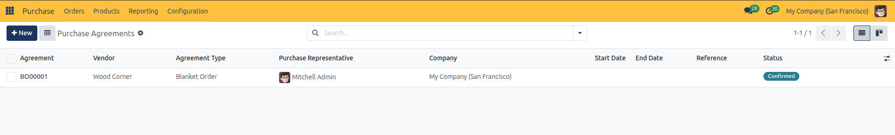
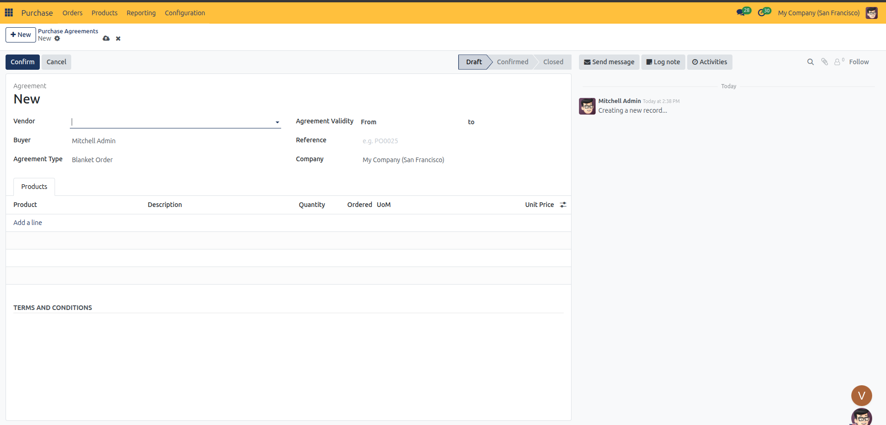
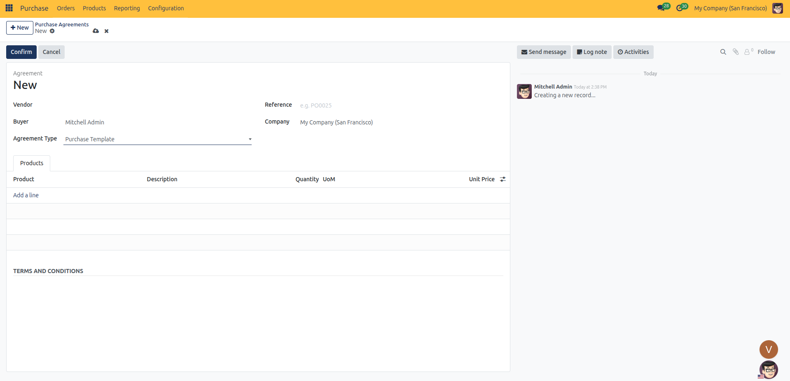

# Purchase Agreements & Blanket Orders

Establish long-term procurement agreements, negotiate locked volume pricing with suppliers, release call-off purchase orders, and utilize recurring purchase templates in CURQ 18.

---

### 1. Understanding Purchase Agreements

In CURQ 18, **Purchase Agreements** provide two distinct mechanisms for managing repeated purchasing requirements: **Blanket Orders** and **Purchase Templates**.

| Feature | Blanket Order | Purchase Template |
| :--- | :--- | :--- |
| **Primary Objective** | Long-term commercial contract with a single supplier for agreed product quantities at pre-negotiated prices over time. | Reusable requisition shopping list for items frequently purchased together across varying vendors. |
| **Vendor Requirement** | **Mandatory**. You must specify the contracted supplier upfront. | **Optional**. Can be left blank to request bids from multiple suppliers. |
| **Agreement Validity** | **Active**. Enforces **From** and **To** dates in the header to govern contract validity. | **Not Applicable**. The validity date fields are hidden; templates remain active indefinitely. |
| **Commitment Tracking** | **Real-Time**. An **Ordered** column tracks cumulative call-off quantities against the agreed total quantity. | **None**. The **Ordered** column is omitted; lines serve purely as re-order templates. |
| **Lifecycle Workflow** | **Draft → Confirmed → Closed** (with options to Cancel or Reset to Draft). | Permanent template without a lifecycle statusbar. |

---

### 2. Navigating the Purchase Agreements Workspace

Access and organize all long-term vendor commitments from a centralized dashboard.

#### How to Open Purchase Agreements
1. Open the **Purchase** application from the main dashboard.
2. In the top navigation bar, select **Orders → Purchase Agreements**.
3. CURQ displays the master list of all active, draft, and completed agreements.

#### List View Columns
The default tabular view displays key contract parameters:

| Column | Description |
| :--- | :--- |
| **Agreement** | The system sequence reference (e.g., `BO00001` for blanket orders). Displays in bold text. |
| **Vendor** | The contracted supplier. For purchase templates, this may be blank. |
| **Agreement Type** | Indicates whether the agreement is a **Blanket Order** or a **Purchase Template**. |
| **Purchase Representative** | Avatar and name of the internal buyer responsible for administering the contract (labeled as **Buyer** on the record form). |
| **Company** | In multi-company environments, the legal entity or operating branch holding the contract. |
| **Start Date** | The date when the agreement takes effect. |
| **End Date** | The contract expiration deadline. Approaching or overdue deadlines are highlighted in red. |
| **Reference** | External reference code, such as the supplier's master agreement number. |
| **Status** | Status badge showing the current stage: **Draft**, **Confirmed**, or **Closed**. |

#### Searching and Filtering Agreements
Use the search bar at the top of the workspace to filter records:
* **My Agreements**: Filters for agreements assigned to you as the responsible Purchase Representative.
* **Blanket Orders**: Filters exclusively for commercial blanket contracts.
* **Purchase Templates**: Displays reusable requisition templates.
* **Draft**: Displays agreements currently being drafted or negotiated.
* **Confirmed**: Displays active contracts against which release orders can be placed.
* **Closed**: Displays finalized or closed agreements.
* **Group By**: Group contracts by **Purchase Representative**, **Status**, or **Ordering Date**.

---

### 3. Creating a Blanket Order

A Blanket Order establishes an agreed total quantity and locked unit price with a supplier, allowing your team to call off partial shipments over an extended duration without renegotiating terms.

#### Step 1: Open the Agreement Form
1. In the **Purchase Agreements** list view, click the blue **+ New** button in the upper-left corner.
2. CURQ opens a blank purchase agreement form in **Draft** status.

#### Step 2: Configure Contract Header Details
Fill in the primary agreement fields:

1. **Vendor**: Select the contracted supplier. This field is mandatory for Blanket Orders.
2. **Buyer**: Defaults to your user account. Change this if assigning the agreement to another procurement specialist.
3. **Agreement Type**: Select **Blanket Order**.
4. **Agreement Validity**: Define the contract timeline by selecting dates in the **From** (start date) and **to** (end date) fields.
5. **Reference**: Enter any external agreement reference (e.g., `PO0025` or the vendor's signed contract identifier).
6. **Company**: Automatically set to your current operating branch (e.g., `My Company (San Francisco)`).

#### Step 3: Add Contract Products and Agreed Pricing
Under the **Products** tab, specify the items, total quantities, and agreed prices:

1. Click **Add a line**.
2. **Product**: Select the item to include under this contract.
3. **Description**: Automatically pulls from the product record; adjust if contract-specific specifications apply.
4. **Quantity**: Enter the total commitment quantity agreed for the contract period (e.g., `100.00 Units`).
5. **Ordered**: Tracks cumulative call-off quantities placed against this contract (starts at `0.00`).
6. **UoM**: Confirm the purchasing unit of measure.
7. **Unit Price**: Enter the negotiated fixed price per unit.
8. Repeat for additional product lines covered by the agreement.

#### Step 4: Define Terms and Conditions
Scroll down to the **TERMS AND CONDITIONS** section below the product table. Document contract terms such as:
* Delivery lead times and minimum batch release quantities.
* Payment terms, billing milestones, and early payment discounts.
* Quality standards, return policies, and dispute resolution guidelines.

#### Step 5: Confirm the Agreement
1. Review all product lines, dates, and prices.
2. Click the blue **Confirm** button in the upper-left action bar.
3. The agreement status advances from **Draft** to **Confirmed**.
4. The **Vendor** selector locks to read-only to prevent unauthorized supplier reassignments.

---

### 4. Issuing Call-Off Release Orders

Once a Blanket Order is confirmed, you do not order all items at once. Instead, you create individual **Release Orders** (purchase orders) as goods are needed.

#### How to Create a Release Order
1. Open the confirmed Blanket Order (**Orders → Purchase Agreements**).
2. Click the blue **New Quotation** button in the top action bar.
3. CURQ automatically creates a new draft Request for Quotation pre-populated with:
   * The **Vendor** from the blanket agreement.
   * The **Buyer** and **Currency**.
   * The product lines with the pre-negotiated **Unit Price** locked in from the contract.
   * A direct link in the **Purchase Agreement** reference field pointing back to the Blanket Order.
4. Adjust the **Quantity** on the order line to reflect the specific batch size needed for this release (e.g., `15.00 Units` out of the 100-unit commitment).
5. Click **Send by Email** to issue the call-off request to the supplier, or click **Confirm Order** to convert it directly into a binding purchase order.

---

### 5. Tracking Commitment Fulfillment

CURQ provides real-time visibility into contract consumption so purchasing teams can track how much of the commitment has been fulfilled and how much remains open.

#### Line-Level Quantity Tracking
On the confirmed Blanket Order under the **Products** tab:
* **Quantity**: Represents the total master commitment (e.g., `100.00 Units`).
* **Ordered**: Automatically calculates the cumulative sum of quantities ordered across all linked purchase orders (e.g., `25.00 Units`).
* **Remaining Commitment**: Subtract the **Ordered** count from the master **Quantity** to determine remaining contract balances.

#### RFQs/Orders Smart Button
In the upper-right stat area of the Blanket Order:
* A smart button labeled **RFQs/Orders** displays the total count of linked purchase documents generated under this agreement.
* Click the smart button to view a dedicated list of all release orders, review their individual confirmation statuses, inspect received quantities, and audit billed totals.

---

### 6. Closing, Cancelling, and Reactivating Agreements

Manage contract lifecycles as commitments are met or supplier relationships evolve:

#### Closing a Completed Agreement
When all committed quantities have been fully ordered, or when the contract validity period expires:
1. Open the confirmed agreement.
2. Click the blue **Close** button in the top action bar.
3. The status badge moves to **Closed**.
4. The agreement is archived from standard active filters while preserving full historical reporting.

#### Cancelling an Agreement
If supplier negotiations collapse or a vendor breaches contract obligations:
1. Open the agreement (in *Draft* or *Confirmed* status).
2. Click the **Cancel** button in the action bar.
3. The agreement moves to **Cancelled**. Linked orders that have already been confirmed remain intact, but no further release orders can be created from this agreement.

#### Resetting a Cancelled Agreement to Draft
If a cancelled agreement is renegotiated or needs revision:
1. Open the cancelled agreement.
2. Click **Reset to Draft** in the top action bar.
3. The record returns to editable **Draft** status, allowing you to update quantities, renegotiate pricing, and re-confirm.

---

### 7. Working with Purchase Templates

A **Purchase Template** functions as a reusable shopping list for recurring procurement needs that do not involve fixed supplier commitments.

#### When to Use a Purchase Template
* Standard office or warehouse supply restocking kits.
* Routine maintenance parts ordered on a regular schedule.
* Multi-vendor requests where quotations must be requested competitively from multiple suppliers each cycle.

#### Configuring a Purchase Template
1. Create a new purchase agreement (**Orders → Purchase Agreements → + New**).
2. Set the **Agreement Type** dropdown to **Purchase Template**.
3. Notice key differences on the form compared to a Blanket Order:
   * **Statusbar Removed**: Templates do not use the `Draft → Confirmed → Closed` stage bar.
   * **Agreement Validity Hidden**: Templates do not enforce contract expiration dates.
   * **Vendor Optional**: The **Vendor** field can remain empty so you can select different suppliers when releasing quotations.
   * **Ordered Column Omitted**: The **Products** table displays only `Product`, `Description`, `Quantity`, `UoM`, and `Unit Price`.
4. Add the standard products, expected quantities, and target unit prices under the **Products** tab.
5. In the **TERMS AND CONDITIONS** section, enter any boilerplate terms or standard shipping instructions.
6. Click **Confirm** to save the template.

#### Releasing Quotes from a Template
1. Open the saved Purchase Template.
2. Click **New Quotation** in the top action bar.
3. CURQ opens a fresh Request for Quotation pre-filled with the products, quantities, and prices defined on the template.
4. Select the target **Vendor** (if not already preset) and proceed with standard quotation or order confirmation workflows.

---

### 8. Next Steps

With Purchase Agreements configured and release workflows active:

* Proceed to [Vendor Management & Supplier Profiles](08-vendor-management.md) to manage vendor contacts, procurement lead times, and default purchasing terms.
* Proceed to [Purchasable Products & Catalogs](09-products-and-variants.md) to manage vendor pricelists, product variants, and packaging units.
