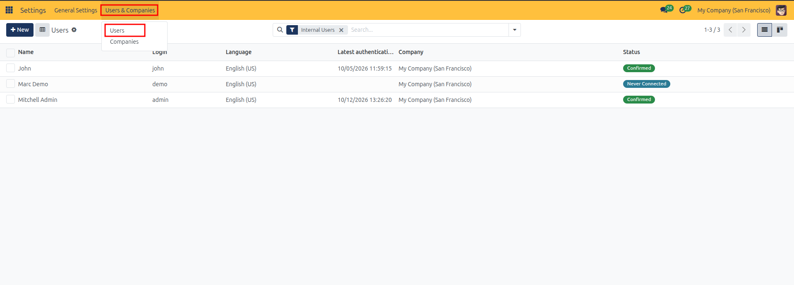
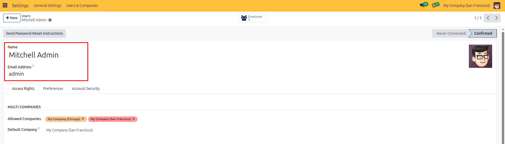
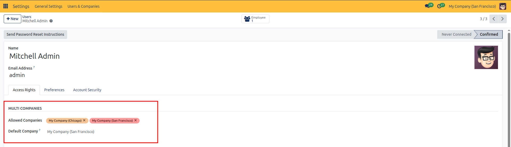
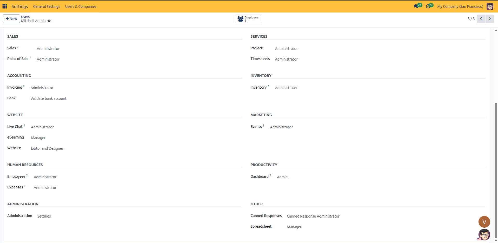
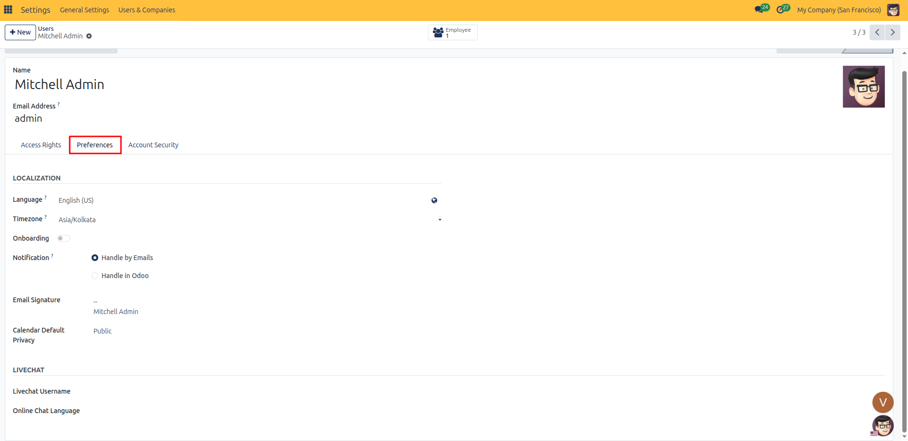
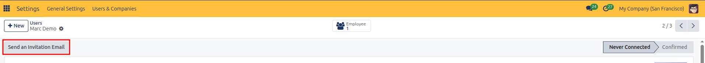
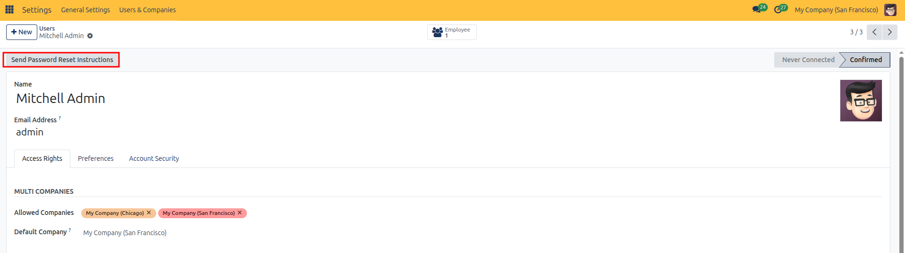
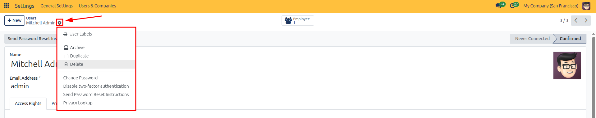
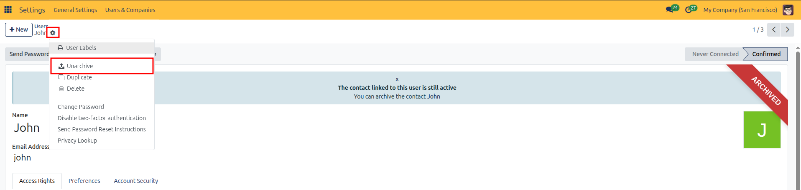

# Creating and Managing Users

Follow these steps to add new team members, configure application roles, assign company branches, and manage account security in CURQ 18:

---

### 1. Open Users Management
1. From the main app menu, open **Settings**.
2. Under the top navigation bar, select **Users & Companies** → **Users**.
3. Click the blue **New** button in the upper-left corner to create a blank user card.

---

### 2. Enter Profile Information
1. In the **Name** field, enter the team member full name (such as *Marc Demo*).
2. In the **Email Address** field, enter their official corporate email address (such as *mark.brown23@example.com*). This email serves as their system login username.
3. *(Optional)* Click the camera icon at the top right to upload a user avatar or profile photo.

---

### 3. Assign Multi-Company Access
If your organization operates multiple companies or branch legal entities, configure company access under the **Access Rights** tab:

* **Allowed Companies**: Select each company branch the user is permitted to switch between and view records for.
* **Default Company**: Choose the primary operating company loaded automatically upon user login.

*(Note: To create new company entities or configure branch hierarchies, see [Multi-Company Setup in General Settings](../../Dashboard/general-settings.md#5-configuring-company-information-and-branding)).*

---

### 4. Configure Application Roles
In the **Access Rights** tab, scroll through the functional application categories to assign permission levels for each installed app:

* **Sales**: Select commercial permissions (*None*, *User: Own Documents Only*, *User: All Documents*, or *Administrator*).
* **Accounting**: Configure billing permissions under **Invoicing** (*None*, *Invoicing*, or *Administrator*) and **Bank** (*Validate bank account*).
* **Inventory**: Set warehouse rights (*None*, *User*, or *Administrator*).
* **Services**: Set permissions for **Project** (*None*, *User*, or *Administrator*) and **Timesheets** (*None*, *User: own timesheets only*, *User: all timesheets*, or *Administrator*).
* **Website**: Set web editing rights (*None*, *Restricted Editor*, or *Editor and Designer*).
* **Human Resources**: Assign access for **Employees** (*None*, *Officer: Manage all employees*, or *Administrator*) and **Expenses** (*None*, *Team Approver*, *All Approver*, or *Administrator*).
* **Administration**: Choose system configuration privileges (*None*, *Access Rights*, or *Settings*).

*(Note: The Access Rights tab only displays controls for currently installed modules. If an application category is missing, check whether the module is installed under the **Apps** menu. For a full breakdown of every application category and access level, see [Assigning Application Access Rights](02-assign-application-access-rights.md)).*

---

### 5. Set User Preferences
Open the **Preferences** tab to configure regional formatting and communication defaults:

* **Language**: Select the interface language used for menus, buttons, and automated document generation.
* **Timezone**: Set the user local timezone to ensure calendar activities and chatter timestamps match their schedule.
* **Notification**: Choose how the user receives internal updates and mentions:
  * **Handle by Emails**: Forwards activity notifications directly to their external email address.
  * **Handle in CURQ**: Keeps messages and activity reminders inside the internal notifications bell and chatter inbox.
* **Email Signature**: Enter a customized email signature block appended to outgoing customer communications.

---

### 6. Send User Invitation
1. Review the configured details and click **Save**.
2. Click **Send an Invitation Email** in the top action bar.
3. CURQ automatically dispatches an onboarding email containing a secure token link.
4. The user clicks the link to set their password and sign in for the first time.
5. The status indicator on the user card automatically transitions from **Never Connected** to **Confirmed**.

---

### 7. Manage Active Status and Password Resets

#### Send Password Reset Instructions
If an active user forgets their credentials or requires a password update:
1. Open their user record from **Settings** → **Users & Companies** → **Users**.
2. In the top action bar, click **Send Password Reset Instructions**.
3. An automated reset email is delivered to their registered email address.

#### Archive (Deactivate) a User
When a team member leaves the company, deactivate their access without losing audit logs or historical activity:
1. Open the user card in **Settings** → **Users & Companies** → **Users**.
2. Click the **Actions** gear icon at the top of the form.
3. Select **Archive** from the dropdown menu and confirm.
4. An **Archived** ribbon displays across their profile, immediately blocking login while preserving all historic invoices, orders, and chatter notes.

#### Reactivate an Archived User
1. Navigate to **Settings** → **Users & Companies** → **Users**.
2. In the search bar, click the search dropdown and select the **Inactive Users** filter.
3. Open the archived user record.
4. Click the **Actions** gear icon and select **Unarchive**.

