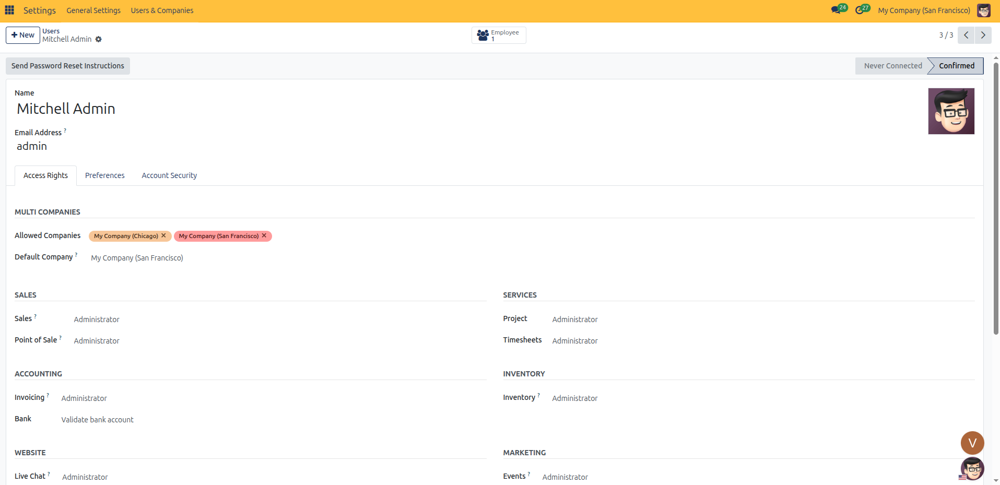
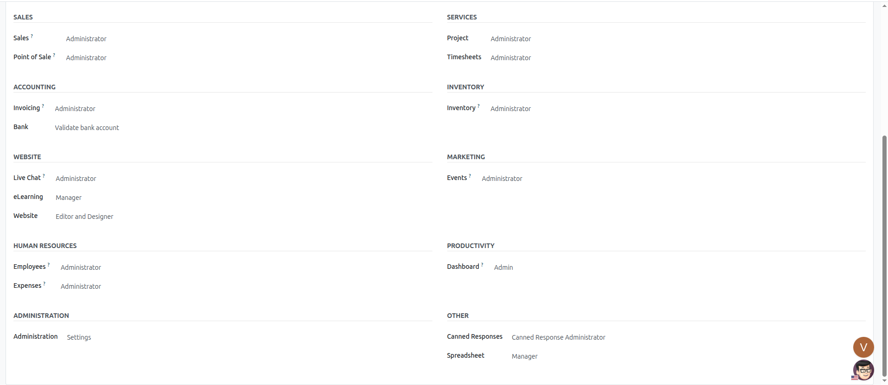

# Assigning Application Access Rights

Follow these steps to configure role-based permissions, application privileges, and administrative access for team members in CURQ 18:

---

### 1. Open User Access Configuration
1. Open the **Settings** application from the main dashboard.
2. Select **Users & Companies** → **Users** in the top menu bar.
3. Select the user whose permissions you want to update from the list view.
4. Click the **Access Rights** tab to view the application categories.

*(Note: The **Access Rights** tab dynamically displays access controls for all modules currently installed in your CURQ system. If you do not see a specific module here, check whether the module is installed under the **Apps** menu. Installing a new business application automatically introduces its corresponding access right categories to this form).*

---

### 2. Commercial and Financial Application Roles
Scroll through the business operations sections to select the user functional role for each installed application:

#### Sales
* **Sales**:
  * **Blank (None)**: The user cannot view the Sales app or access sales orders.
  * **User: Own Documents Only**: The user can view, edit, and create quotations and orders where they are assigned as the salesperson.
  * **User: All Documents**: The user can view and edit all team quotations, sales orders, and customer records.
  * **Administrator**: Full control over sales operations, pricelists, discount rules, quotation templates, and shipping methods.
* **Point of Sale**:
  * **Blank (None)**: The user cannot access retail Point of Sale sessions.
  * **User**: Can open POS registers, scan products, process orders, and register customer payments.
  * **Administrator**: Full control over POS shop settings, payment terminals, floor plans, and cash register closures.

#### Accounting
* **Invoicing**:
  * **Blank (None)**: The user cannot access billing or customer invoices.
  * **Invoicing**: Can create customer invoices, process vendor bills, register customer payments, and download payment receipts.
  * **Administrator**: Full administrative control over billing journals, payment gateways, currencies, and tax mappings.
* **Bank**:
  * **Blank (None)**: The user cannot validate partner banking details.
  * **Validate bank account**: Allows the user to verify and validate newly registered partner bank accounts.

#### Inventory
* **Inventory**:
  * **Blank (None)**: The user cannot view stock levels or warehouse menus.
  * **User**: Can process incoming receipts, perform internal warehouse transfers, and validate outgoing delivery orders.
  * **Administrator**: Full control over warehouse locations, reordering rules, stock routes, product categories, and inventory adjustments.

---

### 3. Operations, HR, and Productivity Roles

#### Services
* **Project**:
  * **Blank (None)**: The user cannot view project boards or task cards.
  * **User**: View and update assigned tasks, log task comments, and track project stages.
  * **Administrator**: Create projects, configure stage workflows, and allocate team members.
* **Timesheets**:
  * **Blank (None)**: The user cannot log timesheet hours.
  * **User: own timesheets only**: Can enter and review only their personal timesheet entries.
  * **User: all timesheets**: Can view and analyze timesheet logs across the entire department.
  * **Administrator**: Full control over timesheet validation, billing rates, and reporting.

#### Human Resources
* **Employees**:
  * **Blank (None)**: The user cannot view employee directory cards.
  * **Officer: Manage all employees**: Can update employee directory profiles, work contact details, and department hierarchies.
  * **Administrator**: Full control over employment contracts, salary structures, and HR configuration.
* **Expenses**:
  * **Blank (None)**: The user cannot submit or approve expense reports.
  * **Team Approver**: Can approve expense sheets for their direct reports.
  * **All Approver**: Can review and approve submitted expense reports across all departments.
  * **Administrator**: Can validate expense bookkeeping entries and configure expense products.

#### Productivity
* **Dashboard**:
  * **Blank (None)**: Standard view permissions for assigned dashboards.
  * **Admin**: Administrative privileges to configure, customize, and share company spreadsheet dashboards.

---

### 4. Website, Marketing, and Communication Roles

#### Website
* **Live Chat**:
  * **Blank (None)**: The user cannot operate live chat support channels.
  * **User**: Can act as an active live support operator and chat with website visitors.
  * **Administrator**: Can create live chat channels, assign operators, and configure canned shortcut responses.
* **eLearning**:
  * **Blank (None)**: The user cannot create or manage online learning courses.
  * **Officer**: Can edit course content, upload presentations, and review attendee progress.
  * **Manager**: Full control over course creation, certifications, and learning platform settings.
* **Website**:
  * **Blank (None)**: The user cannot edit web pages.
  * **Restricted Editor**: Can edit page text, update blog posts, and modify existing images without altering underlying page structure.
  * **Editor and Designer**: Full access to the visual website builder, page creation, header and footer navigation menus, and theme styling.

#### Marketing
* **Events**:
  * **Blank (None)**: The user cannot view or manage event registrations.
  * **Registration Desk**: Access restricted to checking in attendees and validating tickets at the event desk.
  * **User**: Can view events, manage registrations, and process attendee bookings.
  * **Administrator**: Full administrative control over event creation, ticket pricing, stages, and communication templates.

---

### 5. Administration and Other Application Roles

#### Administration
* **Blank (None)**: The user cannot access general system settings or user administration.
* **Access Rights**: Can create users, assign application roles, and send onboarding invitation emails, but cannot alter core system parameters.
* **Settings**: Full system administrator with unrestricted control over all general settings, company configurations, and app installations.

#### Other
* **Canned Responses**:
  * **Blank (None)**: Standard user canned response access.
  * **Canned Response Administrator**: Can create and manage global canned shortcut responses for the entire team.
* **Spreadsheet**:
  * **Blank (None)**: Cannot edit or build spreadsheet templates.
  * **User**: Can create personal spreadsheets and edit assigned sheets.
  * **Manager**: Can manage and publish shared spreadsheets across the company.

---

### 6. Save and Apply Access Changes
1. Once all application roles are configured, click **Save** in the top action bar.
2. If the user is actively logged in, advise them to refresh their web browser to apply the updated menu visibility and permissions immediately.
